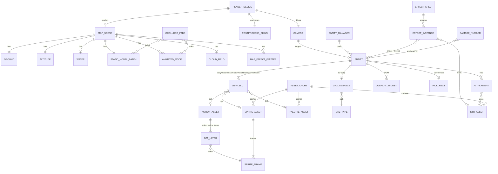

# WebGPU Renderer — AI-Native Specification

_Generated by `/modernize-reimagine webgpu` on 2026-10-15 against `giandotmp3/roBrowser` @ `d0449c2`._

**Spec source:** the legacy WebGL2 renderer.

- **Renderer:** `src/Renderer/**`.
- **Utilities:** `src/Utils/WebGL.js`, `src/Utils/Texture.js`.
- **Code outside the renderer that uploads to the GPU:** `src/Core/Client.js:291-372`, `src/Core/MemoryManager.js:205-261`.
- **Loaders that produce GPU-bound data:** `src/Loaders/{Ground,Altitude,World,Model,Sprite,Action,Str,GR2Loader,MapLoader}.js`.

**Not ported.** This is a rebuild from extracted intent. The legacy code is the *specification*, not the structural template.

**Secrets.** No credentials exist in this scope. Configuration appears only as preference/config keys.

**Related:** [`analysis/roBrowser/ASSESSMENT.md`](../roBrowser/ASSESSMENT.md) (system-wide assessment; renderer is domain 6).

---

## 1. Capabilities

Each capability lists the behavior rules (§5) that define it. **All capabilities are P0** (HITL #1, §6).

| ID | Capability | Rules | Legacy home | Notes |
|---|---|---|---|---|
| C-01 | **Device and frame loop.** Acquire the GPU, apply the fps cap, order the frame, recover from device loss, scale with quality and DPR | R-CTX-001…008 | `Renderer.js`, `Utils/WebGL.js` | Legacy loop also runs ~30 UI callbacks and owns the game clock (`Renderer.tick`, 78 refs) |
| C-02 | **Camera.** Iso, third-person and first-person modes; zoom, pitch and yaw limits; smoothing; quake; persistence | R-CAM-001…011 | `Camera.js` | CPU-side; produces uniforms and the matrices used for picking and overlays |
| C-03 | **Terrain.** Ground mesh, texture atlas, lightmap atlas, tile colour, global light, fog, cell heights | R-MAP-001…007, 023, R-CTX-012 | `Map/Ground.js`, `Loaders/Ground.js` | |
| C-04 | **Water.** Wave displacement, 32-frame animation, opacity | R-MAP-008…011 | `Map/Water.js` | Legacy squares the alpha (FLAG) |
| C-05 | **World models.** Static RSM batch and animated RSM node hierarchy | R-MAP-012…017, R-PERF-004 | `Map/Models.js`, `Map/AnimatedModels.js` | Animated models need a float matrix palette |
| C-06 | **Occluder fade.** Dither/alpha fade of models between the camera and the player | R-MAP-018…020 | `Map/OccluderFade.js` | Uses occlusion queries |
| C-07 | **Sky and atmosphere.** Clear colour from the sky table, cloud billboards, night transition | R-MAP-022, R-CTX-009, R-CTX-013 | `Effects/Sky.js`, `ScreenEffectManager.js` | |
| C-08 | **Entity sprites.** Layered ACT/SPR billboards: direction, palettes, layer z-order, depth correction, shadows, state tints, halos, trails, attachments, removal fade | R-SPR-001…033 | `Entity/*`, `SpriteRenderer.*` | The highest-volume path: 0–200 entities × 1–15 layers, one draw call per layer today |
| C-09 | **Effects.** STR keyframe effects, 2D/3D/cylinder/RSM/QuadHorn effects, auras, spheres, ground tiles, weather, screen tints, duplication and repeat, distance culling | R-EFX-001…018 | `EffectManager.js`, `Effects/*`, `DB/Effects/EffectTable.js` | EffectTable holds ~103 closures that import renderer classes |
| C-10 | **Damage numbers.** Glyph composition, motion curves, skins, crit background | R-DMG-001…009 | `Effects/Damage.js` | One texture per number today |
| C-11 | **Post-processing.** Ordered chain (Bloom, Blur, FXAA, CAS, Cartoon, Vibrance, VerticalFlip, Blind, Upsampling) and the performance-mode scale | R-PP-001…012 | `Effects/PostProcess.js`, `Effects/Shaders/*` | |
| C-12 | **Picking.** Ground ray-march over the GAT, entity screen rectangles with priority, hover events, walk cursor | R-PICK-001…007 | `Map/Altitude.js`, `EntityManager.js`, `EntityRender.js` | Entirely CPU today; no readback |
| C-13 | **Screen-space overlays.** Life, name, chat, cast, room and emblem DOM canvases; signboards; game cursor | R-UI-001…005 | `Entity/Entity{Life,Display,Dialog,Cast,Room,Emblem}.js`, `SignboardManager.js`, `UI/CursorManager.js` | DOM, not GPU, but driven by camera projection |
| C-14 | **GR2 skeletal models.** Guild flag, Emperium, guardians, treasure box | R-GR2-001…006 | `GR2/*`, `Loaders/GR2Loader.js` | Bone palette of 48 |
| C-15 | **Performance mode and culling.** View-area culling, sort cadence, reduced trails, half-rate animated RSM, low-resolution bloom and scene | R-PERF-001…003, R-PP-003 | various | |
| C-16 | **Asset → GPU residency.** SPR, palette, STR and image uploads; magenta keying; POT handling; mipmaps; idle eviction (30 s); purge on loss | R-MAP-024, R-SPR-014, 016, R-PERF-003 | `Core/Client.js`, `Core/MemoryManager.js`, `Utils/Texture.js` | Today this lives *outside* the renderer |
| C-17 | **Map streaming.** Worker-built ground, models, altitude and world, delivered as messages; cancel by load request; same-map teleport | R-CTX-011, §3.2 | `MapRenderer.js`, `Loaders/MapLoader.js`, `Core/Thread.js` | Buffers are structured-cloned today, not transferred |
| C-18 | **Asset viewers.** Map, Model, GR2, Effect and Str viewers built on the renderer | §3.1 | `src/App/*Viewer.js` | Each calls `gl.clear` and raw GL itself |
| C-19 | **2D sprite previews.** Canvas2D path for about 17 UI previews (character select/create, equipment…) | R-SPR-034 | `SpriteRenderer.bind2DContext` | Shares the `Entity` object with the 3D path |
| C-20 | **Screenshot.** Capture of the composed frame | — | `Controls/ScreenShot.js` (html2canvas + `preserveDrawingBuffer`) | Needs an explicit capture path on a WebGPU canvas |

---

## 2. Domain Model

### 2.1 Entities

The table lists the entities that matter for the GPU design. The full inventory, with field types and file:line references, is in the Phase A entity report and is summarised here.

| Entity | GPU resources | Lifecycle | Legacy owner |
|---|---|---|---|
| **RenderDevice** (context, canvas, loop) | adapter, device, swapchain | Session | `Renderer` static class |
| **Camera** | uniform data only | Session | `Camera` static class |
| **MapScene** | per-map uniform buffer (light, fog, diffuse, env) | `setMap` → `free` | `MapRenderer` static class |
| **Ground** | mesh VB (12 floats/vertex), texture atlas, lightmap atlas, tile-colour texture; CPU shadow map copy | Per map | `Map/Ground.js` singleton |
| **Altitude (GAT)** | none (CPU) | Per map | `Map/Altitude.js` |
| **Water** | VB (5 floats/vertex), 32 frame textures | Per map | `Map/Water.js` |
| **StaticModelBatch** | merged VB (9 floats/vertex), per-texture ranges | Per map | `Map/Models.js` |
| **AnimatedModel** | VB (40 B/vertex), RGBA32F node-matrix texture, textures | Per map, N instances | `Map/AnimatedModels.js` |
| **OccluderFade** | occlusion query set (2) | Per frame | `Map/OccluderFade.js` |
| **Entity** (17 mixins) | none directly; references SPR/ACT/palette assets | Packet-driven add, fade, remove | `EntityManager` |
| **SpriteAsset (SPR)** | one texture per frame (R8 indexed or RGBA8); 256×1 palette texture | MemoryManager, 30 s idle eviction | `Core/Client.js` |
| **ActionAsset (ACT)** | none (CPU) | MemoryManager | — |
| **PaletteAsset (.pal)** | 256×1 RGBA texture | MemoryManager | — |
| **SpriteDraw** (per layer) | today a mutable global (`SpriteRenderer.*`, ~15 fields per draw) | Per layer per frame | `SpriteRenderer` |
| **Attachment** | references SPR or STR | add/remove | `EntityAttachments` |
| **EffectSpec** (EffectTable) | none; data plus closures | Static | `DB/Effects/EffectTable.js` |
| **EffectInstance** (STR / 2D / 3D / Cylinder / RSM / Aura / …) | shared quad VB; per-instance textures (leak in TwoD/ThreeD/Cylinder) | spam → end tick → cleanup | `EffectManager` keyed by constructor |
| **StrAsset** | layer material textures | MemoryManager | `Core/Client.js` |
| **DamageNumber** | one canvas-composed texture each | 1.5 s / 3 s | `Effects/Damage.js` |
| **CloudField** | 7 cloud textures, 150 billboards | Per map | `Effects/Sky.js` |
| **GR2Type** / **GR2Instance** | VB/IB per submesh, textures, emblem texture; 48-bone palette | Refcounted per path / per entity | `GR2/GR2ModelRenderer.js` |
| **PostProcessChain** | 2 ping-pong targets (rgb8 + depth16), Bloom internal target | Per resize | `Effects/PostProcess.js` |
| **PickRect** | none (CPU, screen space) | Rebuilt each frame | `EntityRender` → `EntityManager` |
| **OverlayWidget** / **Signboard** | none (DOM) | Per entity / per map | Entity mixins / `SignboardManager` |

### 2.2 Relationships



### 2.3 Shared state the rebuild must own explicitly

1. **GPU handles in module-level singletons.** Every renderer module keeps `_program`/`_buffer`/`_list` at module scope. The rebuild scopes all of these to one `RenderDevice` and per-map `MapScene` objects.
2. **`SpriteRenderer` is a single mutable "current sprite"** written before each of thousands of draws. The rebuild uses per-layer instance records.
3. **Draw order is implicit.** It comes from a hard-coded pass list (R-CTX-010), `zIndex++`, `runWithDepth`, the `renderBeforeEntities` split and hard-coded aura IDs. The rebuild makes these explicit pass and pipeline state.
4. **Asset lifetime lives outside the renderer** (`Client.js` uploads, `MemoryManager` deletes).
5. **The game clock and UI tick live inside the renderer loop.** `Renderer.tick`, `Session.serverTick` and `Events.process` advance there.
6. **Effect positions alias entity position arrays** (`EffectManager.js:637-639`).
7. **Known leaks:**
   - `TwoDEffect` and `ThreeDEffect` never free their textures.
   - `Cylinder` creates a buffer per instance and frees only the class-level one.

---

## 3. Interface Contracts

The renderer is an in-process module, so its boundary is a JavaScript API plus worker messages. The worker channel is written as **AsyncAPI**. The synchronous facade is written as an AsyncAPI-style operation catalog with JS signatures; it has no HTTP surface. Frequencies come from code evidence.

### 3.1 Inbound facade (callers → renderer)

```yaml
# AsyncAPI-style operation catalog: in-process renderer facade
asyncapi: 3.0.0
info: { title: roBrowser Renderer Facade, version: 1.0.0 }
operations:
  device.init:            { action: receive, summary: "Create device + canvas; options {alpha, antialias}", callers: [Engine/GameEngine.js:145, App/*Viewer.js], frequency: once (+ legacy re-init per map at MapRenderer.js:571) }
  loop.register:          { action: receive, summary: "fn(tick) per frame (legacy Renderer.render(fn))", callers: "~30 UI components + MapEngine/GameEngine/LoginEngine", frequency: per-event register; callback per-frame }
  loop.unregister:        { action: receive, summary: "Renderer.stop(fn?) — no arg clears all", frequency: per-event }
  clock.tick:             { action: send, summary: "Renderer.tick (ms) — read by 15 modules / 78 refs", frequency: per-frame write }
  viewport.size:          { action: send, summary: "Renderer.width/height CSS px (162 refs, UI layout)", frequency: on resize }
  viewport.resize:        { action: receive, summary: "Recompute size × DPR × quality; projection; PP targets", callers: [GraphicsOption.js:183, window resize debounced 500 ms] }
  scene.setMap:           { action: receive, payload: "mapName: string (e.g. 'prontera.gat', instance prefixes stripped)", callers: [MapEngine.js:771, App/MapViewer.js], frequency: per map change }
  scene.onLoad:           { action: send, summary: "hook fired after map ready", callers: [MapEngine.js:626] }
  scene.free:             { action: receive, callers: [GameEngine.js:207, LoginEngine.js:939, MapEngine.js:858,1305] }
  scene.state:            { action: send, payload: "{currentMap, loading, fog, light}", frequency: polled/per-event }
  entities.add/remove:    { action: receive, payload: "Entity (mixin-composed)", callers: "MapEngine/Entity.js:133,165,182,382; MapEngine.js:637-671", frequency: per packet }
  entities.query:         { action: receive, summary: "get(gid), getByCID, forEach, getClosestEntity, getLowestHpEntity", frequency: per event (83 call sites) }
  entities.hover/focus:   { action: send, summary: "getOverEntity/setOverEntity, getFocusEntity", frequency: per mouse event + per frame }
  entity.renderEntity2D:  { action: receive, summary: "Preview render of an Entity into a Canvas2D ctx (C-19)", callers: "CharSelectCommon.js:1162, EquipmentCommon.js:756, Guild.js:2411, Sense.js:186, ItemPreview.js:277", frequency: per frame while open }
  effects.spam:           { action: receive, payload: "EF_Init_Par {effectId, ownerAID, position[3], startTick, persistent, repeatEnd, otherAID, otherPosition, ownerEntity}", callers: 42 sites, frequency: per packet }
  effects.spamSkill*:     { action: receive, payload: "(skillId, destAID, position, tick, srcAID)", callers: "MapEngine/Entity.js:1268-1817, Skill.js:142, Item.js:248" }
  effects.remove:         { action: receive, payload: "(ctorOrNull, AID, effectID) — keyed by constructor", callers: "MapEngine/Entity.js:304-341,1907; Skill.js:434" }
  damage.add:             { action: receive, payload: "(amount, entity, tick, weapon, type:bitflags)", callers: "MapEngine/Entity.js:725-766 (16), Main.js:692,711" }
  screenEffects:          { action: receive, summary: "setNight, parseStatus(EFST), cleanStatusEffect, clean", callers: "MapEngine/Entity.js:2056, StatusIcons.js" }
  weather.startOrRestart: { action: receive, payload: "(ownerAID, tick)", callers: "ProcessCommand.js:1014-1018, Skill.js:41-45" }
  signboards.add:         { action: receive, payload: "(x, y, dbSignboard)", callers: [MapEngine.js:685] }
  items.add/remove:       { action: receive, payload: "(gid, itemid, identify, count, x, y, z, dropeffectmode, showdropeffect)", callers: "MapEngine/Item.js:43,56,65" }
  camera.control:         { action: receive, summary: "setTarget, init, rotate, setZoom, zoomFinal, angleFinal, setQuake", callers: "MapControl.js:90-280, Mobile.js:283-362, Joystick*, EffectTable FUNC (19x setQuake)" }
  camera.matrices:        { action: send, summary: "projection, modelView, direction — read by previews, overlays, picking", frequency: per frame }
  altitude.query:         { action: receive, summary: "getCellType/Height, setCellType, width/height — CPU collision; candidate to leave renderer", callers: "8 modules" }
  assets.textureUpload:   { action: receive, summary: "LEGACY: Client.js creates GL textures for spr/pal/str — REBUILD: AssetResidency API", callers: "Core/Client.js:291-372" }
  assets.evict:           { action: receive, summary: "LEGACY: MemoryManager gl.deleteTexture; forceClean on loss", callers: "MemoryManager.js:205-261, Renderer.js:190" }
  graphics.settings:      { action: receive, summary: "GraphicsSettings.* read per frame (performanceMode, viewArea, bloom*, fxaa*, cas*, cartoon*, vibrance*, blur*, occluderFade*, fpslimit, pixelPerfectSprites); MapPreferences.fog; Configs.quality/enableMipmap" }
  screenshot.capture:     { action: receive, summary: "Controls/ScreenShot.js — needs composed frame + DOM overlays" }
```

**Outside callers that bypass the facade today.** These must be routed through it.

- `UI/Components/Enchant/Enchant.js:495-553` has its own inline GL program, a full-screen tint.
- The viewers call `gl.clear` and the model renderers directly (`ModelViewer.js:163-270`, `GrannyModelViewer.js:160-243`, `EffectViewer.js:64-183`, `StrViewer.js:70-189`, `App/MapViewer.js:89-92`).
- `GraphicsOption.js:229-233` calls `MemoryManager.remove(gl, '*.spr')` to force re-upload.
- `Loaders/GR2Loader.js:16` imports `Renderer/GR2/gr2Math.js`, a reverse dependency.

### 3.2 Map-streaming worker channel

```yaml
asyncapi: 3.0.0
info: { title: roBrowser Map Loader Worker, version: 1.0.0 }
channels:
  mapLoad:
    messages:
      LOAD_MAP:           { direction: main→worker, payload: { rswFilename: string }, returns: uid }
      MAP_PROGRESS:       { direction: worker→main, payload: { percent: number }, frequency: several per load }
      MAP_ALTITUDE:       { direction: worker→main, payload: { cells: Float32Array, width: int, height: int } }
      MAP_WORLD:          { direction: worker→main, payload: { water: { level, type, waveHeight, waveSpeed, wavePitch, animSpeed, images: "blobURL[32]" }, light: { longitude, latitude, diffuse: "f32[3]", ambient: "f32[3]", opacity }, sound: "[]", effect: "[]" } }
      MAP_GROUND:         { direction: worker→main, payload: { width, height, textures: "blobURL[]", lightmap: Uint8Array, lightmapSize, tileColor: Uint8Array, shadowMap: Uint8Array, mesh: "Float32Array (12/vtx: pos3 nrm3 uv2 lmUV2 tcUV2)", meshVertCount, waterMesh: "Float32Array (5/vtx)", waterVertCount } }
      MAP_MODELS:         { direction: worker→main, payload: { buffer: "Float32Array (9/vtx: pos3 nrm3 uv2 alpha1)", infos: "[{filename, vertOffset, vertCount, texture: blobURL}] sorted by texture" } }
      MAP_ANIMATED_MODEL: { direction: worker→main, payload: { filename, animLen, frameRatePerSecond, shadeType, alpha, textures, instances: "mat4[]", nodes: "[{name, parentname, vertices, tvertices, faces, pos, rotangle, rotaxis, scale, offset, mat3, rot/pos/scaleKeyframes}]", box }, frequency: N per load }
      LOAD_MAP_COMPLETE:  { direction: worker→main, payload: { uid, arguments: [success, error, filename] } }
    bindings: { filter: "events with request !== current _loadRequest are dropped (MapRenderer.js:407-413)" }
```

Image data crosses this channel as blob URLs and is decoded on the main thread. Buffers are copied, not transferred, today.

### 3.3 Outbound dependencies (renderer → rest of client)

| Dependency | Contract | Notes |
|---|---|---|
| `Client.loadFile(url, cb)` | Returns a decoded object or blob URL | 57 call sites inside the renderer |
| `Texture.load` / `WebGL.texture` | Image or TGA → magenta key → POT canvas → GPU | 21 call sites; no cache |
| DOM | `<canvas class="ro-scene">` on `body`, context-loss overlay, per-entity overlay canvases, signboard components | |
| UI calls | `UIManager.fixResizeOverflow/showErrorBox/removeComponents`, `Background.setLoading/setPercent/remove`, `Cursor.render/setType`, `JoystickUI.onRestore` | Reverse coupling |
| Mouse state | **Writes** `Mouse.screen.{width,height}` and `Mouse.world.{x,y,z}`; reads `Mouse.screen.{x,y}` and `Mouse.intersect` | |
| Audio | `BGM.play/stop`, `SoundManager.stop/playPosition` (per frame through map sounds), effect, entity and damage sounds | |
| Session and settings | `Session.Entity` (66 reads), `Session.Playing`, writes `Session.serverTick`; `GraphicsSettings.*` (and writes `bloom=false` on error); `DB.getMap` | |
| Context-loss event | No broadcast; other modules poll `Renderer.contextLost` | |

### 3.4 GPU feature surface the rebuild must cover

| Category | Legacy usage | WebGPU equivalent |
|---|---|---|
| Baseline | WebGL2 required, no extensions | `navigator.gpu` adapter/device |
| Blending | Alpha and additive (`SRC_ALPHA, ONE`), plus data-driven (src, dst) pairs from the STR D3DBLEND table (~11×11 combinations) and the 2D/3D table | Pipeline cache keyed by (blend, depth, topology) |
| Depth | LEQUAL; `depthMask` and depth test toggled per draw; clip-z rewrite in the sprite vertex shader | Depth-state pipeline variants |
| Instancing | WaterfallEffect only | Instance step mode, used heavily for sprites |
| Float textures | RGBA32F + `texelFetch` (animated RSM matrices) | Storage buffer |
| Occlusion queries | `ANY_SAMPLES_PASSED_CONSERVATIVE`, async | Occlusion `GPUQuerySet` + resolve + map |
| Render targets | rgb8 + depth16 ping-pong; Bloom at 1/4 or 1/8 | rgba8unorm + depth16unorm |
| Mipmaps | `generateMipmap` in 9 modules | Compute/blit mip generator |
| Indexed colour | R8 index texture + 256×1 palette, manual bilinear in the shader | r8unorm + palette (or a texture array) |
| Dynamic buffers | `bufferSubData` per frame in 6 modules | `queue.writeBuffer` / ring buffer |
| Screenshot | `preserveDrawingBuffer:true` + html2canvas | Explicit copy-to-texture/readback |

**Shader programs to re-express in WGSL** (about 30):

- **Main renderers:** Sprite, Ground, Water, GridSelector, Models + OccluderFade, AnimatedModels + OccluderFade, GR2.
- **Effects:** StrEffect, RsmEffect, Cylinder, MagicRing, PropertyGround, QuadHorn, GroundAura, SwirlingAura, Level99Bubble, RainWeather, SpiritSphere, WarlockSphere, LockOnTarget, MagicTarget, Tiles, LPEffect, SpiderWeb, FlatColorTile, Waterfall ×2.
- **Post-process:** Bloom ×2, GaussianBlur, FXAA, CAS, Cartoon, Vibrance, Blind, Upsampling, VerticalFlip.
- **Outside the renderer:** the Enchant overlay.

---

## 4. Non-Functional Requirements (inferred from legacy)

| ID | Requirement | Evidence |
|---|---|---|
| NFR-01 | **Frame rate.** Hold 60 fps at the default cap with ~200 entities × up to 15 layers (~3,000 sprite layers), hundreds of effects, 10–200 model batches and up to 9 post passes. The legacy path issues one draw per sprite layer, so the rebuild must batch | R-CTX-003; entity report per-frame counts |
| NFR-02 | **Frame pacing.** The fps cap snaps to interval boundaries; uncapped when ≤ 0; 60 cap outside the game | R-CTX-003 |
| NFR-03 | **Resolution.** Backing store = CSS size × DPR × quality%. Resize debounced 500 ms. Performance mode renders the scene at 0.75× and upsamples | R-CTX-008, R-PP-003 |
| NFR-04 | **Map load.** Parsing stays off the main thread (worker). The main thread only uploads. Progress is reported. Stale loads are cancellable | §3.2 |
| NFR-05 | **GPU memory.** Idle sprite, palette and STR assets are evicted after 30 s. No per-instance texture or buffer leaks (fixes the legacy TwoD/ThreeD/Cylinder leaks) | `MemoryManager.js:27,111-171` |
| NFR-06 | **Resilience.** Recover from device or context loss without a page reload: purge assets, show the overlay, rebuild on restore. A render error degrades gracefully (legacy turns bloom off) | R-CTX-005…007 |
| NFR-07 | **Platforms.** Browser, PWA and Electron 41 (Chromium). Today WebGL2 is the hard floor, and SwiftShader+Intel detection disables bloom | R-CTX-001, R-PP-004 |
| NFR-08 | **Limits.** No device-limit checks exist today. The rebuild must check `maxTextureDimension2D`, `maxStorageBufferBindingSize` and similar limits (the legacy animated-RSM matrix texture can exceed them) | interface report §6 |
| NFR-09 | **Determinism for testing.** Visual constants (§5 appendix) are the acceptance oracle. Draw order must be reproducible given the same inputs | R-CTX-010, R-SPR-030 |
| NFR-10 | **Bundle and code.** ES modules, path aliases, Vite; `src/Vendors` frozen; lint and format rules from AGENTS.md | AGENTS.md |

---

## 5. Behavior Contract

The 143 Given/When/Then rules below are the **acceptance tests** for the rebuild. They were extracted from source with file:line citations and a confidence level. Rules tagged **[FLAG]** describe probable legacy bugs. For each one, HITL #1 decides whether to keep it (bit-exact parity) or fix it (§6).

**Shared conventions:**

- **Units:** one world unit is one GAT cell, which is 35 sprite pixels at the default sprite scale.
- **Sprite position mapping:** world `(x, y, z)` is drawn at `(x+0.5, -z, y+0.5)`.
- **`runWithDepth(a, b, c)`:** `SpriteRenderer.runWithDepth(depthTest, depthWrite, disableDepthCorrection)`.

Source paths below are relative to `src/`.

### 5.1 CTX: context, init, frame loop

#### R-CTX-001: WebGL2 context is required, with fixed attributes
- Given: the client starts.
- When: the renderer creates its context.
- Then: it requests `webgl2` (falling back to the `experimental-webgl2` name) with alpha false, depth true, stencil false, antialias true, premultipliedAlpha false, preserveDrawingBuffer true and powerPreference "high-performance". If no context is available it throws and does not render.
- Source: Utils/WebGL.js:29-43, 46-66
- Confidence: high
- Priority hint: core

#### R-CTX-002: Default GL state
- Given: renderer init or context restore.
- Then: clearDepth is 1.0, the depth test is on with LEQUAL, and blending is on with SRC_ALPHA / ONE_MINUS_SRC_ALPHA. Every pass that changes the blend function restores this default afterwards.
- Source: Renderer/Renderer.js:171-176, 225-229; Effects/StrEffect.js:511; GR2/GR2ModelRenderer.js:874-876
- Confidence: high
- Priority hint: core

#### R-CTX-003: Frame-rate cap
- Given: `fpslimit` is 60 (the default).
- When: a frame is due.
- Then:
  - In-game, frames are throttled to an interval of 1000/fpslimit ms, and the last-frame time snaps to the interval boundary (`now - elapsed % interval`) so timing does not drift.
  - `fpslimit <= 0` means uncapped (one frame per rAF).
  - Outside the game (`!Session.Playing`, e.g. character select), the cap is forced to 60 whenever it is 0 or above 60.
- Source: Renderer/Renderer.js:111, 346-371; Preferences/Graphics.js:32
- Confidence: high
- Priority hint: core

#### R-CTX-004: Order of work in each frame
- Given: a frame passes the throttle.
- Then, in order:
  1. `Session.serverTick` is advanced by the Date.now delta.
  2. Timed events are processed.
  3. Each render callback runs.
  4. The cursor is rendered.
  5. The next rAF is scheduled.
- Source: Renderer/Renderer.js:373-413
- Confidence: high
- Priority hint: core

#### R-CTX-005: A render error turns bloom off
- Given: a render callback throws and the context is not lost.
- Then: if bloom is on, it is turned off permanently as a resource-pressure fallback. If the context is lost, the loop exits.
- Source: Renderer/Renderer.js:389-407
- Confidence: high
- Priority hint: important

#### R-CTX-006: Context loss
- Given: the browser fires `webglcontextlost`.
- Then:
  - The default is prevented and rendering stops.
  - Cached `.bmp/.jpg/.png/.spr/.pal/.str` data is purged.
  - A full-screen overlay is shown: rgba(0,0,0,0.85), z-index 10000, title "Graphics Context Lost".
  - Resize is ignored while the context is lost.
- Source: Renderer/Renderer.js:183-205, 279-281
- Confidence: high
- Priority hint: core

#### R-CTX-007: Context restore
- Given: `webglcontextrestored` fires.
- Then: the overlay is hidden, the default GL state (R-CTX-002) is reapplied, the active post-process modules are re-initialised, the framebuffers are resized and rendering resumes.
- Source: Renderer/Renderer.js:211-238; Effects/PostProcess.js:136-170
- Confidence: high
- Priority hint: core

#### R-CTX-008: Resize debounce, quality scaling and device pixel ratio
- Given: a window of 1920×1080 CSS px, DPR 2 and quality 50.
- When: a resize event occurs.
- Then:
  - The resize runs 500 ms after the last event.
  - The canvas backing store is 1920·0.5·2 × 1080·0.5·2 = 1920×1080, while its CSS size stays 1920×1080 (so the image is upscaled).
  - The projection is `perspective(vFov, w/h, near 1, far 1000)`, with vFov as the full vertical angle in degrees.
  - Quality is read from `Configs 'quality'`, which the options UI mirrors from GraphicsSettings.quality.
- Source: Renderer/Renderer.js:269-312; Utils/gl-matrix.js:292-296; UI/Components/GraphicsOption/GraphicsOption.js:179-182
- Confidence: high
- Priority hint: core

#### R-CTX-009: Clear colour comes from the map's sky
- Given: a map with an entry in `WeatherTable.sky`.
- Then: the clear colour is that entry's skyColor. A map with no entry gets an opaque black clear and no clouds.
- Source: Renderer/Effects/Sky.js:51-70
- Confidence: high
- Priority hint: important

#### R-CTX-010: Order of the map render passes
- Given: in-game.
- Then, each frame:
  1. post-process prepare (clears colour and depth)
  2. camera update
  3. ground
  4. map effect emitters
  5. ground ray-pick and grid selector
  6. sky clouds
  7. occluder-fade begin
  8. static RSM models
  9. animated RSM models
  10. entity cull
  11. GR2 models
  12. screen effects, before-entities part
  13. effects, before-entities pass
  14. entities, non-effect
  15. water
  16. faded model pass (static, then animated)
  17. effects, after-entities pass
  18. effect entities
  19. damage numbers
  20. signboards
  21. screen effects
  22. sounds
  23. entity pick
  24. memory clean
  25. post-process
- Source: Renderer/MapRenderer.js:263-380
- Confidence: high
- Priority hint: core

#### R-CTX-011: Map name normalisation and same-map teleport
- Given: the server sends "0061@tower" or "003#prontera".
- Then: they become "1@tower" and "prontera". If the new name equals the current one once the extension is stripped (.gat vs .rsw), no reload happens: only entities, damage and effects are cleared.
- Source: Renderer/MapRenderer.js:144-161, 192-210
- Confidence: high
- Priority hint: important

#### R-CTX-012: Global light setup
- Given: RSW light values diffuse D, ambient A, longitude and latitude in degrees.
- Then:
  - The env colour is `1-(1-D)(1-A)` per channel.
  - The light direction is `-(RotY(longitude)·RotX(latitude)·(0,1,0))`.
- Source: Renderer/MapRenderer.js:427-456
- Confidence: high
- Priority hint: core

#### R-CTX-013: Night-mode transition
- Given: night is turned on.
- Then: every 8 ms, diffuse R and G each drop by 0.005 until both are ≤ 0.5 (blue is untouched), and env is recomputed each step. Day mode reverses this up to the map's diffuse.
- Source: Renderer/ScreenEffectManager.js:240-280
- Confidence: high
- Priority hint: nice

---

### 5.2 CAM: camera

#### R-CAM-001: Zoom limits
- Given: an outdoor map, isometric mode and the default config.
- When: the player zooms with the wheel or Ctrl+right-drag.
- Then:
  - `zoomFinal` is clamped to [|altitudeTo−altitudeFrom|·MIN_ZOOM, ·MAX_ZOOM] = [65·1, 65·5] = [65, 325].
  - Indoors the maximum is 65·2.5 = 162.5.
  - MAX_ZOOM can be overridden with the `CameraMaxZoomOut` config.
  - The wheel step is 15·zoomStepMult; Ctrl-drag moves zoom by Δy·(15·mult/10) per pixel.
- Source: Renderer/Camera.js:26-27, 118-119, 139, 271, 371-380, 421-434
- Confidence: high
- Priority hint: core

#### R-CAM-002: Initial camera
- Given: entering a map.
- Then:
  - Pitch starts at 230° and yaw at 0.
  - Outdoors, zoom is the saved preference (default 125).
  - Indoors (DB.isIndoor), zoom is the saved indoorZoom (default 125), with pitch 230 and yaw −40.
- Source: Renderer/Camera.js:268-306; Preferences/Camera.js:19-20
- Confidence: high
- Priority hint: core

#### R-CAM-003: Pitch limits
- Given: Shift+right-drag.
- Then:
  - Pitch moves by Δy/screenHeight·300°.
  - Isometric clamp is [190, 270]; indoor clamp is [220, 240].
  - Third-person clamp is [175, 270] and first-person [90, 270]; in those modes a plain drag also changes pitch.
- Source: Renderer/Camera.js:29-37, 358-369, 402-406
- Confidence: high
- Priority hint: core

#### R-CAM-004: Yaw limits
- Given: a right-drag.
- Then:
  - Yaw moves by −Δx/screenWidth·720°.
  - Outdoor clamp is [−360, 360]; indoor clamp is [−60, −25].
  - Both the current and target yaw are rewrapped by ±360 when they pass ±180.
- Source: Renderer/Camera.js:120-121, 132-133, 383-400
- Confidence: high
- Priority hint: core

#### R-CAM-005: Double right-click resets
- Given: two right-presses within 500 ms and less than 10 px apart.
- Then:
  - With Shift: pitch resets (230 outdoors, 240 indoors).
  - With Ctrl: zoom resets to 125.
  - Otherwise: yaw resets (0 outdoors, −25 indoors).
- Source: Renderer/Camera.js:322-346
- Confidence: high
- Priority hint: important

#### R-CAM-006: Smoothing
- Given: frame Δt of 16 ms.
- Then:
  - lerp = min(Δt·0.006, 1) = 0.096.
  - Position follows the target by lerp (or snaps when the `smooth` preference is off, or in first person).
  - Zoom and both angles approach their targets by lerp·2.
  - Angles are taken mod 360.
- Source: Renderer/Camera.js:490-530
- Confidence: high
- Priority hint: core

#### R-CAM-007: View matrix
- Then: `MV = T_z((0−zoom)/2) · R_x(pitch) · R_y(yaw) · T(−x−0.5, h+zOffset, −y−0.5)`. The orbit focus is the negation of that last translation. The normal matrix is the inverse-transpose of MV.
- Source: Renderer/Camera.js:535-550
- Confidence: high
- Priority hint: core

#### R-CAM-008: Camera direction index
- Given: yaw of 50°.
- Then: Camera.direction = floor((50+22.5)/45) % 8 = 1. This index is added to the entity direction for sprite selection.
- Source: Renderer/Camera.js:533
- Confidence: high
- Priority hint: core

#### R-CAM-009: First- and third-person modes
- Given: the `FirstPersonCamera` / `ThirdPersonCamera` configs.
- Then:
  - First person (zoomFinal == 0): vFov 50, zOffset 2, the player's own entity is hidden, zoom step ×0.3.
  - Third person (zoomFinal < 65): vFov 30, zOffset 1.5, MIN_ZOOM 0.2.
  - Otherwise isometric: vFov 15.
  - Every mode change triggers a resize.
- Source: Renderer/Camera.js:269-292, 436-482, 516-524
- Confidence: high
- Priority hint: important

#### R-CAM-010: Screen quake
- Given: setQuake(start, duration defaulting to 650 ms, side 1.0, latitude 0.2, zoom 0.24).
- Then: every frame within the window, position, zoom and pitch get (rand[−0.25..0.25] + amount)·0.1 added (pitch noise is /15 instead of /10), with the amount's sign flipped each frame.
- Source: Renderer/Camera.js:39, 212-263
- Confidence: high
- Priority hint: nice

#### R-CAM-011: Zoom is saved
- Then: zoom is saved to the preferences 3 s after the last change, with indoor and outdoor zoom kept separately.
- Source: Renderer/Camera.js:177-183, 554-562
- Confidence: high
- Priority hint: nice

---

### 5.3 MAP: ground, water, models, lighting, fog

#### R-MAP-001: Ground shading
- Then: `c = tex·tileColor` (when the tile-colour UV ≠ (0,0)), then `·clamp(max(N·L,0)·D + A)`, then `·clamp(env)`. If lightmaps are on: `rgb = rgb·lightmap.a + clamp(lightmap.rgb)`, so lightmap alpha is the shadow and lightmap rgb is additive colour.
- Source: Renderer/Map/Ground.fs:35-59; Ground.vs (dot product)
- Confidence: high
- Priority hint: core

#### R-MAP-002: Lightmap quality preference
- Given: `smoothlight` 0 (the default).
- Then: lightmap rgb is posterised to 16 levels (`floor(c·255/16)·16/255`). Value 2 applies pow(rgb, 1.1); value 1 uses the raw lightmap. The `lightmap` preference turns the whole term off.
- Source: Renderer/Map/Ground.js:94-96; Ground.fs:28-33, 48-57; Preferences/Map.js:31, 38
- Confidence: high
- Priority hint: important

#### R-MAP-003: Ground alpha cutout
- Then: ground texels with alpha < 0.1 are discarded.
- Source: Renderer/Map/Ground.fs:37-38
- Confidence: high
- Priority hint: core

#### R-MAP-004: Fog formula (used by most shaders)
- Given: fog is on in the preferences and the map has a fog entry.
- Then: `f = smoothstep(near, far, gl_FragCoord.z/gl_FragCoord.w)` and `rgb = mix(rgb, fogColor, f)`, with alpha preserved. near and far are the DB values ×240, and factor is stored but unused. Maps with no fog entry have no fog.
- Source: Renderer/MapRenderer.js:122-129, 266-267, 561-568; Ground.fs:61-65; SpriteRenderer.fs:163-167
- Confidence: high
- Priority hint: core

#### R-MAP-005: Ground texture atlas
- Given: N textures.
- Then: they are packed in a grid round(√N) wide as 258 px cells (the 256 px texture plus a 1 px border made by drawing it stretched to 258 first). The atlas is power-of-two (POT) with linear filtering and optional mipmaps.
- Source: Renderer/Map/Ground.js:265-320
- Confidence: high
- Priority hint: important

#### R-MAP-006: Lightmap atlas
- Then: each lightmap is an 8×8 block, alpha = shadow byte and rgb = colour, placed in a POT atlas. Tile UVs sample the inner 0.125–0.875 of each block, giving half-texel padding.
- Source: Loaders/Ground.js:224-255, 445-455
- Confidence: high
- Priority hint: core

#### R-MAP-007: Tile colour is BGRA
- Then: the tile's colour bytes are stored as BGRA and converted to RGBA. Cells with no top tile get colour 0.
- Source: Loaders/Ground.js:265-282
- Confidence: high
- Priority hint: important

#### R-MAP-008: Water wave
- Given: waveSpeed s, pitch p, height h and tick t.
- Then:
  - frame = t/(1000/60).
  - offset = (frame·s mod 360) − 180.
  - For each vertex: `y += sin(rad(offset + 0.5·p·(x+z+diff)))·h`, where diff is +1/−1/0 in a 2×2 checker pattern.
  - Wave height and water level are the RSW values /5.
- Source: Renderer/Map/Water.js:125, 154-157; Water.vs; Loaders/Ground.js:58-60
- Confidence: high
- Priority hint: core

#### R-MAP-009: Water texture animation
- Then: 32 water textures are used, with index `floor(frame/animSpeed) % 32` at frame = tick/16.67.
- Source: Renderer/Map/Water.js:101-104, 160
- Confidence: high
- Priority hint: core

#### R-MAP-010: Water opacity is applied twice [FLAG]
- Given: water type 0.
- Then: uOpacity is 0.8 (1.0 for types 4 and 6). The shader sets a = uOpacity and then multiplies by uOpacity again, so the effective alpha is 0.64. The texture's own alpha is ignored, and water is unlit.
- Source: Renderer/Map/Water.js:80; Water.fs:22-28
- Confidence: high
- Priority hint: core

#### R-MAP-011: Water geometry and depth
- Then:
  - Water quads exist only where at least one ground corner is below the water surface, and the UVs repeat every 5 ground tiles.
  - Water is drawn after the opaque entities, with the depth test on and depth write off.
- Source: Loaders/Ground.js:547-585; Renderer/Map/Water.js:162-166; MapRenderer.js:347-348
- Confidence: high
- Priority hint: core

#### R-MAP-012: Static RSM model shading
- Then: `rgb·clamp((lightmapPref ? max(N·L,0) : 1)·D + A)·clamp(env)`, alpha = tex.a × the model's alpha. RSM ≥ 1.4 stores alpha as a byte /255; RSM2 always does. Texels with alpha exactly 0 are discarded. Models are drawn with depth test and depth write on while global alpha blending is on, with no sorting of translucent parts.
- Source: Effects/Shaders/GLSL/Models.fs:26-47; Loaders/Model.js:787, 916; Map/OccluderFade.js:235-238
- Confidence: high
- Priority hint: core

#### R-MAP-013: Animated RSM ignores the lightmap preference [FLAG]
- Then: animated models always apply N·L diffuse, even when the `lightmap` preference is off; static models switch to full diffuse in that case.
- Source: Renderer/Map/AnimatedModels.fs:33; Models.fs:36
- Confidence: high
- Priority hint: nice

#### R-MAP-014: RSM instance transform
- Then: `T(pos + mapOffset)·RotZ·RotX·RotY·Scale`. For RSM ≥ 2.2 this is followed by `·Scale(flip)·T(offset)·T(0, box.range.y, 0)·T(box.offset)`.
- Source: Loaders/Model.js:1125-1149
- Confidence: high
- Priority hint: core

#### R-MAP-015: RSM normals
- Then: shadeType NONE uses constant normals, FLAT uses per-face normals, and SMOOTH averages normals within each smoothGroup. Any other value is treated as NONE.
- Source: Loaders/Model.js:382-399, 540-575
- Confidence: high
- Priority hint: important

#### R-MAP-016: Animated RSM timing
- Given: fps = the model's frameRatePerSecond (default 30) and animLen frames.
- Then:
  - The keyframe position is `tick % animLen`, with tick in ms used directly as the frame value.
  - The matrices are recomputed only when floor(frame/(1000/(fps/1.14))) changes; in performance mode the divisor is fps/2.
  - If animLen is 0 it is derived as max keyframe + 1.
- Source: Renderer/Map/AnimatedModels.js:318-347, 462, 708-721, 878
- Confidence: medium (the ms-as-frame equivalence needs SME confirmation)
- Priority hint: important

#### R-MAP-017: Animated RSM node hierarchy
- Then: `global = parentGlobal·T(posKey or node.pos)·R(slerp rotKey or axis-angle)·S(scaleKey or node.scale)`, and `final = T(−center.x, −max.y, −center.z)·global·T(offset unless only node)·mat3`. Each instance matrix is the instance transform × the node's final matrix, packed into an RGBA32F texture.
- Source: Renderer/Map/AnimatedModels.js:728-793
- Confidence: high
- Priority hint: important

#### R-MAP-018: Occluder fade is enabled
- Given: occluderFade is 'dither' or 'alpha' (default 'off'), opacity 0.25, radius 5 cells.
- Then: the fade is active except in first-person mode.
- Source: Renderer/Map/OccluderFade.js:97-99; Preferences/Graphics.js:82-84
- Confidence: high
- Priority hint: important

#### R-MAP-019: Occluder detection
- Then:
  - Each frame the models are redrawn with colour and depth writes off, inside an ANY_SAMPLES_PASSED_CONSERVATIVE query, keeping only fragments within 0.7 cells of the eye→player axis and more than 0.5 cells before the focus.
  - Last frame's result drives the strength: up by Δt/150 ms when blocked, down by Δt/300 ms when clear, with Δt capped at 100.
  - A new query is not issued while one is still pending.
- Source: Renderer/Map/OccluderFade.js:56-64, 136-160, 250-266; Effects/Shaders/GLSL/OccluderFade.glsl:136-140
- Confidence: high
- Priority hint: important

#### R-MAP-020: Occluder fade shape and modes
- Then:
  - **Shape:** fade = radial(1 − smoothstep(R/2, R, distance to axis)) × along(1 − smoothstep(−0.5, 0, signed distance past the focus)) × strength. Visibility = 1 − fade·(1 − opacity). The cut plane tilts toward the view axis once the horizontal fraction drops below 0.3–0.6.
  - **Dither mode:** discard when visibility ≤ a 4×4 Bayer threshold, (b+0.5)/16.
  - **Alpha mode:** the opaque pass discards fade ≥ 0.01. A blend pass drawn after the entities (depth test on, depth write off) draws only the faded region, with alpha × visibility.
- Source: Effects/Shaders/GLSL/OccluderFade.glsl:94-159; Map/OccluderFade.js:212-226, 277-281; MapRenderer.js:350-353
- Confidence: high
- Priority hint: important

#### R-MAP-021: Grid selector
- Given: the mouse ray hits a walkable cell.
- Then:
  - grid.tga is drawn at alpha 0.6, tinted rgb(50,240,160) via source-atop, on that cell's four corner heights, lowered by 0.1 world units so it sits slightly above the ground.
  - In captcha floor-pick mode, every walkable cell in the square range is drawn.
  - Non-walkable cells show no selector.
- Source: Renderer/Map/GridSelector.js:52-80, 102-160; GridSelector.vs; MapRenderer.js:290-311
- Confidence: high
- Priority hint: core

#### R-MAP-022: Sky clouds
- Given: the sky entry has a cloudColor.
- Then:
  - 150 billboards of 500×500, using cloud1–7.tga, tinted with cloudColor.
  - Each spawns within ±35 cells of the player at z = −10 and drifts randomly (±0.01 cells per 25 ms horizontally, ±0.001 vertically, Δt capped at 250).
  - Alpha fades in over 1 s, holds for a 6 s life, fades out over 2 s, then the cloud respawns.
  - Depth test on, depth write off, no depth correction.
- Source: Renderer/Effects/Sky.js:23, 99-213
- Confidence: high
- Priority hint: important

#### R-MAP-023: Cell height interpolation
- Then: height(x, y) bilinearly interpolates the GAT cell's four corners at (x+0.5, y+0.5) and is negated. Positions outside the map return 0.
- Source: Renderer/Map/Altitude.js:125-152
- Confidence: high
- Priority hint: core

#### R-MAP-024: Magenta colour key on images
- Given: a BMP, PNG or JPG pixel with r > 230, g < 20 and b > 230.
- Then: the pixel becomes fully transparent black. The canvas is then resized to POT (stretched) for upload.
- Source: Utils/Texture.js:156-178; Utils/WebGL.js:203-207
- Confidence: high
- Priority hint: core

---

### 5.4 SPR: sprites and entities

#### R-SPR-001: Sprite direction
- Given: Camera.direction 1, entity.direction 3 and action 2.
- Then: the visual direction is (1+3+8)%8 = 4 and the act index is (2·8+4) % actions.length. A negative action renders as IDLE.
- Source: Renderer/Entity/EntityRender.js:325-326, 766-770
- Confidence: high
- Priority hint: core

#### R-SPR-002: Spherical billboard
- Then: the view matrix's rotation is replaced with identity after translating to the sprite's position, so sprites always face the screen.
- Source: Renderer/SpriteRenderer.vs:25-44, 60-64
- Confidence: high
- Priority hint: core

#### R-SPR-003: Sprite pixel scale
- Then:
  - world size = pixels/175·xSize, where xSize = 5, i.e. 35 px per cell.
  - Baby jobs use 4. Warp portals use 20 (4× larger).
  - Offsets are scaled the same way, minus 0.5 on Y.
- Source: Renderer/SpriteRenderer.js:86-89; Entity/EntityView.js:256; Entity/EntityAction.js:252-256
- Confidence: high
- Priority hint: core

#### R-SPR-004: Entity lift
- Then: every entity body is drawn 0.2 cells above its position, and the picking rectangle uses the same lift.
- Source: Renderer/Entity/EntityRender.js:197, 360, 520, 527, 535, 544
- Confidence: high
- Priority hint: core

#### R-SPR-005: Billboard depth correction
- Given: depth correction is enabled.
- Then:
  - Each vertex's clip-space z is replaced by the depth where its camera ray meets a vertical plane through the sprite centre, whose normal is the flattened camera forward.
  - z is then capped with `min(original, corrected)`, except for NPCs (ignoreDepthMinCap), which take the corrected z outright.
  - The aim: sprites are not cut by the ground they stand on, and water still covers their submerged part.
- Source: Renderer/SpriteRenderer.vs:69-89; Entity/EntityRender.js:533-541
- Confidence: high
- Priority hint: core

#### R-SPR-006: z-index bias within an entity
- Then: `clip.z −= (zIndex·0.01 + depth)/max(zoom, 1)`. zIndex auto-increments after each draw, so later layers win ties.
- Source: Renderer/SpriteRenderer.vs:90; SpriteRenderer.js:71-72
- Confidence: high
- Priority hint: core

#### R-SPR-007: Player and mercenary layer order (bodyZ = 250)
- Given: a PC facing a front direction (not 3–5) with weapon, shield, robe, three headgears and a cart.
- Then, by zIndex:
  - shadow −1
  - cart shadow −1, cart 1 (drawn first, no depth write)
  - robe: see R-SPR-009
  - body 150
  - head 300
  - mid headgear 350
  - top headgear 450
  - lower headgear 550
  - weapon and weapon trail 500
  - shield 550
- When the direction is 2–5 ("behind"), the shield is instead drawn first at −1 with no depth write.
- When the direction is 3–5 ("back"), the robe is drawn after the hats at bodyZ + correction, and the cart at bodyZ+500 with no depth write.
- Riding doubles bodyZ to 500; riding while walking toward the front adds another 250. A rider that is sitting or walking toward the front has its body z doubled to 300.
- Source: Renderer/Entity/EntityRender.js:358-518
- Confidence: high
- Priority hint: core

#### R-SPR-008: Duplicate headgear suppression
- Then: the mid headgear is skipped if it equals the lower one, and the top is skipped if it equals the lower or the mid.
- Source: Renderer/Entity/EntityRender.js:462-484
- Confidence: high
- Priority hint: important

#### R-SPR-009: Robe z-correction
- Then:
  - **Default:** front 1, back 400; sitting: front −100, back 550.
  - **Tall robe** (robeHeight + 25, or +50 when riding and facing front, or +0 when sitting, exceeds bodyHeight + 64): front −300, back 1 (100 when riding); sitting: front −450, back −100 (1 when riding).
- Source: Renderer/Entity/EntityRender.js:379-402
- Confidence: high
- Priority hint: important

#### R-SPR-010: Cart offsets
- Then:
  - Pixel offsets by visual direction 0–7: (0,−30), (30,−10), (40,0), (30,10), (0,20), (−30,10), (−40,0), (−30,−10).
  - Super Novices always use cart 0.
  - The cart only draws while Session.Playing.
  - An idle cart shows frame 0.
- Source: Renderer/Entity/EntityRender.js:414-422, 791-832, 944-946
- Confidence: high
- Priority hint: important

#### R-SPR-011: Shadow
- Then:
  - A shadow is drawn unless the entity is DIE or SIT, its job is 45, or hideShadow is set.
  - It sits at the cell height + 0.05 and always uses animation frame 0.
  - Its scale comes from ShadowTable[job] (default 1.0; dropped items 0.25).
  - It ignores effectColor.
  - Depth test on, depth write off, depth correction on.
- Source: Renderer/Entity/EntityRender.js:330-342, 919-922, 1125-1135; Entity/EntityView.js:258; ItemObject.js:54
- Confidence: high
- Priority hint: core

#### R-SPR-012: Ground shadow darkens sprites
- Then: the sprite's rgb is multiplied by the shadow factor: the average of a 6×6 neighbourhood of the 8-per-tile shadowmap around the entity, /255. Cells with no ground count as 255. Before the map has loaded the factor is 1.0.
- Source: Renderer/Map/Ground.js:394-425; Loaders/Ground.js:291-327; SpriteRenderer.fs:159; Entity/EntityRender.js:301
- Confidence: high
- Priority hint: important

#### R-SPR-013: Depth write by entity type
- Then:
  - PC, mercenary, homunculus, falcon and NPC bodies write depth.
  - Mobs and all other types only test depth.
  - Falcons use zIndex 1000; everything else 150.
- Source: Renderer/Entity/EntityRender.js:519-552
- Confidence: high
- Priority hint: core

#### R-SPR-014: Palette sprites
- Then:
  - Indexed frames upload as LUMINANCE indices, POT-padded and centred.
  - Indices whose palette colour is exactly magenta (255,0,255) become 0.
  - The shader treats index 0 as transparent and bilinearly blends the four neighbouring palette lookups.
  - Indexed frames use NEAREST filtering; RGBA frames use LINEAR unless `pixelPerfectSprites` (default off) forces NEAREST.
  - The palette texture is 256×1 RGBA with NEAREST filtering.
- Source: Core/Client.js:313-361; Loaders/Sprite.js:350-385; SpriteRenderer.fs:115-151
- Confidence: high
- Priority hint: core

#### R-SPR-015: Palette selection
- Then:
  - An external .pal (body or head palette) is used when one is set; otherwise the sprite's own palette.
  - Mounted, costume and body-style bodies use the palette that belongs to the sprite actually drawn.
  - Halter-lead mounts use their own palettes only if the archive has them; otherwise the rider's.
- Source: Renderer/Entity/EntityRender.js:763; Entity/EntityView.js:613-647
- Confidence: high
- Priority hint: important

#### R-SPR-016: RGBA sprite frames
- Then: frames are read bottom-up, so they are flipped vertically. The source is ABGR, reordered to RGBA, and alpha 0 forces the whole pixel to 0 so no fringe appears.
- Source: Loaders/Sprite.js:386-410
- Confidence: high
- Priority hint: core

#### R-SPR-017: Final sprite colour
- Then: `colour = layer.colour (ACT bytes /255) × entity.effectColor`, then `rgb ×= shadow factor`, then the fragment = tex × colour. Fragments with tex.a == 0 are discarded, and if colour.a == 0 the draw is skipped.
- Source: Renderer/Entity/EntityRender.js:1124-1135; SpriteRenderer.js:27; SpriteRenderer.fs:141-160; Loaders/Action.js:129-132
- Confidence: high
- Priority hint: core

#### R-SPR-018: effectColor composition
- Then: effectColor = bodyState × healthState × effectState × virtue × flash, multiplied per channel.
- Source: Renderer/Entity/EntityState.js:34-59
- Confidence: high
- Priority hint: core

#### R-SPR-019: Body state tints
- Then:
  - Stone: rgb 0.1, animation paused.
  - Stone-wait: 0.3.
  - Freeze: (0, 0.4, 0.8) plus an ice attachment and the FREEZE2 pose.
  - Sleep and stun: head attachments.
- Source: Renderer/Entity/EntityState.js:236-289
- Confidence: high
- Priority hint: important

#### R-SPR-020: Health state tints
- Then: Curse multiplies by (0.5, 0.15, 0.1) and adds an attachment at opacity 0.5. Poison multiplies by (0.9, 0.4, 0.8). Silence adds an emotion attachment at depth 5.
- Source: Renderer/Entity/EntityState.js:310-364
- Confidence: high
- Priority hint: important

#### R-SPR-021: Invisibility states
- Then:
  - INVISIBLE: alpha 0.
  - Hide, Cloak, Chasewalk: alpha 0, or a black silhouette when the local player has intravision.
  - Camouflage, Stealth Field: alpha 0.1.
  - Shadow Form: rgba 0.2.
  - Intravision shows black for all of these.
- Source: Renderer/Entity/EntityState.js:431-478
- Confidence: high
- Priority hint: important

#### R-SPR-022: Buff (virtue) tints
- Then:
  - Quicken: B = 0.
  - Explosion Spirits: (1, 0.75, 0.75).
  - Blade Stop: 0.25.
  - Energy Coat / Bunshin: (0.5, 0.5, 0.85).
  - Overthrust: G and B 0.75.
  - Warm: G and B 0.4.
  - Soul Link: (0.35, 0.35, 0.9, 0.9).
  - Undead property: R 0.7, B 0.65.
  - Marionette: (1, 0.34, 0.71, 0.5).
  - Berserk: (1, 0.4, 0.4).
  - Later checks overwrite earlier ones.
- Source: Renderer/Entity/EntityState.js:118-185
- Confidence: high
- Priority hint: nice

#### R-SPR-023: Additive bodies
- Given: Berserk on a non-shadow layer, or Marionette.
- Then: the entity's layers are drawn with blend SRC_ALPHA, ONE (additive).
- Source: Renderer/Entity/EntityRender.js:835-841; SpriteRenderer.js:38-42
- Confidence: high
- Priority hint: important

#### R-SPR-024: Assumptio halo
- Then: every layer is redrawn at 1.15× scale, colour (1,1,1,0.6), zIndex −100, with no depth write.
- Source: Renderer/Entity/EntityRender.js:588-623
- Confidence: high
- Priority hint: nice

#### R-SPR-025: After-image trails
- Given: Energy Coat, Bunshin, Hallucination Walk, Quicken, Overthrust, Explosion Spirits, Berserk, or a fast move.
- Then:
  - Snapshots are taken every 80 ms; blur types 3 and 5 use 560 ms, and fast moves 30 ms.
  - Up to 5 snapshots are kept (2 in performance mode; type 4 keeps 1).
  - Snapshots are taken while walking for types 1 and 3, during attacks or skills for type 5, and once for type 4.
  - Alpha = 0.4·(1 − age/duration), where duration is 400 ms (800 for types 3 and 4); type 3 is doubled. Snapshots below 0.05 are dropped.
  - Types other than 1 are white.
  - zIndex is the original −10−i, with no depth write.
- Source: Renderer/Entity/EntityRender.js:628-730, 852-865
- Confidence: high
- Priority hint: nice

#### R-SPR-026: Removal fade
- Then:
  - Out of sight: fades over 1000 ms.
  - Death of a non-PC, non-wug entity: plays DIE and then fades over 5000 ms.
  - A dying PC loops its DIE animation and is not removed.
  - Any other removal is instant.
  - Alpha ×= 1 − elapsed/delay.
- Source: Renderer/Entity/Entity.js:458-497; Entity/EntityRender.js:1137-1140; EntityManager.js:428-444
- Confidence: high
- Priority hint: core

#### R-SPR-027: Animation frame selection
- Then:
  - The default delay is the ACT delay (file value ×25 ms), or 150 ms.
  - Attacks use the ACT delay, else attack_speed/frames (at least 100 ms).
  - An idle or sitting PC/mercenary body or robe shows frame = headDir. The head's frames are split into 3 head-direction groups.
  - Non-repeating actions hold their last frame and then switch to `next`.
  - animation.speed and animation.length override these values.
- Source: Renderer/Entity/EntityRender.js:889-1053; Loaders/Action.js:60
- Confidence: high
- Priority hint: core

#### R-SPR-028: Walk cadence follows distance
- Given: a walk distance of 2 cells and an ACT delay of 100 ms.
- Then: frame = floor(2·170.2/100) % motionCount = 3. The constant is 4.6·0.37·4·25. The phase is shared by all parts within one tick, and falcons are excluded.
- Source: Renderer/Entity/EntityRender.js:47-48, 986-1018
- Confidence: high
- Priority hint: core

#### R-SPR-029: Head turning (lookTo)
- Then: turning by 1–2 steps changes only the head (headDir 1 = right, 2 = left, with the body offset by ±1). A larger turn, or a further turn in the same head direction, rotates the body and straightens the head.
- Source: Renderer/Entity/Entity.js:505-572
- Confidence: high
- Priority hint: important

#### R-SPR-030: Entity draw order
- Then:
  - Entities are sorted far→near by depth = clip w, with a tie-break of (GID % 100)/1000.
  - They are re-sorted when the list changes, or every 3 frames (6 in performance mode).
  - Non-effect entities are drawn before water; effect entities after.
- Source: Renderer/EntityManager.js:280-285, 409-450; MapRenderer.js:345, 356
- Confidence: high
- Priority hint: core

#### R-SPR-031: Sprite attachments
- Then:
  - Attachments are drawn with effectColor set to white × the attachment's opacity.
  - Head attachments are lifted 100 px.
  - Direction-aware attachments use the visual direction.
  - zIndex is 1 for behind-entity attachments and 500 otherwise, with no depth write.
  - Behind-entity attachments ignore the ground shadow.
  - Non-repeating attachments are removed at their last frame unless stopAtEnd is set; `duration` caps repeating ones.
- Source: Renderer/Entity/EntityAttachments.js:172-216, 296-347
- Confidence: high
- Priority hint: important

#### R-SPR-032: STR attachments scale with the entity
- Then:
  - The scale is ((xSize+ySize)/2)/5.
  - The pivot is (320,320) with no 0.5 vertical base.
  - xOffset and yOffset are multiplied by 0.2·35·scale.
  - A persistent hat effect reuses the last valid frame on blank keys and restarts when all layers are blank.
- Source: Renderer/Effects/StrEffect.js:309-327, 346-391
- Confidence: high
- Priority hint: nice

#### R-SPR-033: Dropped item falls
- Then: z = max(groundHeight, z0 − t/40), i.e. 25 cells per second.
- Source: Renderer/ItemObject.js:60-64
- Confidence: high
- Priority hint: nice

#### R-SPR-034: 2D preview path (UI)
- Then: the canvas 2D renderer caches up to 8 colour variants per (frame, palette) and draws mirrored or rotated, with Y −17.5 px for the cell middle.
- Source: Renderer/SpriteRenderer.js:207-291
- Confidence: high
- Priority hint: nice

---

### 5.5 EFX: effects

#### R-EFX-001: Effect toggles
- Then: the `/effect` preference off suppresses all spawned effects. `/mineffect` uses each effect's `min` STR when it has one, falling back to the full file.
- Source: Renderer/EffectManager.js:86-127, 556-559; Preferences/Map.js:45-52
- Confidence: high
- Priority hint: important

#### R-EFX-002: Duplicated effect instances
- Then: duplicate −1 is treated as 999, values are capped at 999, and the default is 1. Instances are spaced timeBetweenDupli apart (default 200 ms).
- Source: Renderer/EffectManager.js:574-597
- Confidence: high
- Priority hint: important

#### R-EFX-003: Effect timing
- Then: start = spawn + delayStart; on repeats it is delayOffset + delayLate. end = start + duration when duration > 0, otherwise −1 (open-ended).
- Source: Renderer/EffectManager.js:671-698
- Confidence: high
- Priority hint: important

#### R-EFX-004: Effect repeat
- Then: persistent and repeatEnd effects re-spawn at endTick + repeatDelay (with a duration) or at cleanup + repeatDelay, until repeatEnd passes.
- Source: Renderer/EffectManager.js:214-260
- Confidence: high
- Priority hint: important

#### R-EFX-005: Effect distance culling
- Then: effects whose position is more than 20 cells from the player in XY (viewArea in performance mode) are not rendered, but their lifetime and repeat still advance.
- Source: Renderer/EffectManager.js:427-498
- Confidence: high
- Priority hint: important

#### R-EFX-006: Before- and after-entity passes
- Then: the effect's own flag decides its pass, otherwise its constructor default. Aura IDs 200, 201, 202, 362, 397, 398 and 881 are always drawn before entities.
- Source: Renderer/EffectManager.js:368-381, 456-459
- Confidence: high
- Priority hint: core

#### R-EFX-007: STR keyframes
- Then:
  - key = elapsed/1000·fps, wrapped by maxKey when persistent.
  - Between a source key and a delta key, values are linear (from + delta·k).
  - aniframe follows anitype: 1 normal, 2 clamp, 3 loop, 4 reverse.
  - The effect is removed at maxKey.
  - Colours are stored /255.
- Source: Renderer/Effects/StrEffect.js:93-198, 286-333; Loaders/Str.js:49-52, 121-122
- Confidence: high
- Priority hint: core

#### R-EFX-008: STR blending
- Then: the blend function is D3DBLEND[src], D3DBLEND[dst], mapped as 1 ZERO, 2 ONE, 3 SRC_COLOR, 4 1−SRC_COLOR, 5 SRC_ALPHA, 6 1−SRC_ALPHA, 7 DST_ALPHA, 8 1−DST_ALPHA, 9 DST_COLOR, 10 1−DST_COLOR, 11 SRC_ALPHA_SATURATE, 14 CONSTANT_COLOR, 15 1−CONSTANT_ALPHA. Depth write is off.
- Source: Renderer/Effects/StrEffect.js:410, 431-443, 480, 506-511
- Confidence: high
- Priority hint: core

#### R-EFX-009: STR billboard
- Then: 1/35 world unit per pixel, the pivot is pos − (320,320), Y is lowered 0.5 (except attachments), and clip z is reduced by 0.1. Pure-black or zero-alpha texels are discarded.
- Source: Renderer/Effects/StrEffect.vs:17-50; StrEffect.fs:66-69; StrEffect.js:379-396
- Confidence: high
- Priority hint: core

#### R-EFX-010: STR effects are never fogged [FLAG]
- Then: uFogUse is never set, so fog is off. Near and far are uploaded ×100 and ×150 anyway.
- Source: Renderer/Effects/StrEffect.js:485-488; StrEffect.fs:71
- Confidence: high
- Priority hint: nice

#### R-EFX-011: 2D, 3D, cylinder and QuadHorn blend tables use a different numbering [FLAG]
- Then: blendMode n (1–15) uses GL order (5 DST_COLOR, 7 SRC_ALPHA, …), not the STR/D3D table. The source factor is always SRC_ALPHA; 0 or an out-of-range value means normal alpha blending.
- Source: Renderer/Effects/ThreeDEffect.js:417-422, 758-773; TwoDEffect.js:683-685; Cylinder.js:383-385; QuadHorn.js:249-251
- Confidence: high
- Priority hint: important

#### R-EFX-012: Alpha envelope for 2D and 3D effects
- Then:
  - fadeIn: alpha ramps 0→alphaMax over the first 1/4 of the duration.
  - fadeOut: alphaMax→0 over the last 1/4.
  - sparkling: alphaMax·(cos(steps·11·n°)+1)/2, with steps from 0–100.
  - The result is clamped to [0,1].
- Source: Renderer/Effects/ThreeDEffect.js:584-596; TwoDEffect.js:582-587
- Confidence: high
- Priority hint: important

#### R-EFX-013: Overlay flag
- Then: an overlay effect disables the depth test and the depth correction. A non-overlay effect tests depth; 2D effects also write it.
- Source: Renderer/Effects/ThreeDEffect.js:742-750; TwoDEffect.js:659
- Confidence: high
- Priority hint: important

#### R-EFX-014: Additive effect families
- Then: GroundAura, SwirlingAura, Level99Bubble, SpiritSphere, WarlockSphere, PokJuk fireworks and Waterfall use SRC_ALPHA, ONE.
- Source: Effects/GroundAura.js:237; SwirlingAura.js:324; Level99Bubble.js:509; SpiritSphere.js:168; WarlockSphere.js:180; PokJukWeatherEffect.js:54; WaterfallEffect.js:238
- Confidence: high
- Priority hint: important

#### R-EFX-015: Level-99 aura
- Then:
  - Shown when the aura preference > 0 and base level ≥ 99 (server-overridable via `aura`) and the entity is visible.
  - Preference 1 shows only EF_LEVEL99_3; 2 shows LEVEL99, _2 and _3.
  - Changing the preference reloads the aura.
- Source: Renderer/Entity/EntityAura.js:27-99
- Confidence: high
- Priority hint: important

#### R-EFX-016: Map-flag weather
- Then: the WeatherTable `effects[map].weather` value starts snow, rain, fireworks, leaves, sakura, or cloud1–8 at map load.
- Source: Renderer/ScreenEffectManager.js:49-145
- Confidence: high
- Priority hint: important

#### R-EFX-017: Weather parameters
- Then (1 rag tick = 25 ms):
  - **Snow:** 2 flakes per tick; each lives 8 s with a 250 ms fade-in and fades over the last 1/5; radius 60 cells; spawn height 18–22; falls 0.1 cell per tick.
  - **Rain:** 10 drops per tick, at most 1100; radius 70; height 22–42; wind 0.14±0.06 at up to 0.55 rad; thunder every 5–60 s; up to 600 puddles at most 0.45 alpha.
  - **Sakura:** one every 150 ms; 15 s life.
- Source: Effects/SnowWeather.js:18-45; RainWeather.js:25-107; SakuraWeatherEffect.js:24-40
- Confidence: high
- Priority hint: nice

#### R-EFX-018: Poison screen tint
- Given: the local player is poisoned.
- Then: a 4000×4000 billboard of (0.5, 0, 0.5, 0.15) is drawn at the player with no depth.
- Source: Renderer/Effects/PoisonEffect.js:28-52; ScreenEffectManager.js:162-188
- Confidence: high
- Priority hint: nice

---

### 5.6 DMG: damage numbers

#### R-DMG-001: Lifetime and colour
- Then:
  - Lifetime is 1500 ms (combo 3000 ms).
  - Colours: SP (0.13, 0.19, 0.75); heal green; a hit on a PC red; combo or crit (0.9, 0.9, 0.15); otherwise white.
  - Alpha = 1 − elapsed/delay.
- Source: Renderer/Effects/Damage.js:343-421, 660
- Confidence: high
- Priority hint: core

#### R-DMG-002: Normal hit motion
- Given: perc = t/1500 and damageMotion 0.
- Then:
  - Position = entity + (4·perc, −4·perc).
  - z = entity z + 2 + 5·sin(−π/2 + π(0.5 + 1.5·perc)).
  - Scale = (1 − perc)·4 × the ACT layer scale.
  - Motion 1 drifts −x only, 2 is vertical only, 3 drifts +x only.
- Source: Renderer/Effects/Damage.js:587-615, 652-658; Preferences/Graphics.js:49
- Confidence: high
- Priority hint: core

#### R-DMG-003: Heal motion
- Then: scale = max((1 − 2·perc)·3, 0.8); z = +2, rising (perc − 0.4)·5 after 40% of the lifetime.
- Source: Renderer/Effects/Damage.js:627-632
- Confidence: high
- Priority hint: important

#### R-DMG-004: Miss and Lucky [FLAG]
- Then: perc = t/800, scale 0.5, z = +3.5 + 7·perc, so it is invisible after 800 ms while still living until 1500 ms. "Miss" is shown only if the `miss` preference is on.
- Source: Renderer/Effects/Damage.js:424-431, 635-650
- Confidence: high
- Priority hint: important

#### R-DMG-005: Combo title
- Then: scale = min(perc, 0.05)·70, z = +7 + perc. Only the newest combo per entity is drawn. A non-final combo is hidden after 15% of its lifetime.
- Source: Renderer/Effects/Damage.js:566-584
- Confidence: medium (the code itself says "TODO: fix it")
- Priority hint: important

#### R-DMG-006: Critical background
- Then: a critbg sprite at 0.6 scale, colour 0.66 grey, offset (0, −6) is drawn behind the number, and effect id 1 (the hit effect) is spawned. Blue-crit combos use the bluemsg variant.
- Source: Renderer/Effects/Damage.js:369-415
- Confidence: high
- Priority hint: important

#### R-DMG-007: Number texture
- Then:
  - Digit glyphs are laid out with 2 px padding on a POT×DPR canvas.
  - The value is floored; negative values are ignored.
  - With `enableDmgSuffix`: values ≥ 1e8 show as /1e6 with "M", values ≥ 1e6 as /1e3 with "K".
- Source: Renderer/Effects/Damage.js:299-479
- Confidence: high
- Priority hint: important

#### R-DMG-008: Damage skins
- Then: skins are 0 default, 1 NewNumber, 2 Han, 3 Invi. Skin 3 suppresses all numbers. PACKETVER < 20220821 forces skin 0.
- Source: Renderer/Effects/Damage.js:36-61, 271-279
- Confidence: high
- Priority hint: important

#### R-DMG-009: Damage depth
- Then: numbers are drawn after the entities with the depth test off, and the per-item depth bias is the list index. SpriteRenderer.depth is left at the last index afterwards.
- Source: Renderer/Effects/Damage.js:670-676; MapRenderer.js:358
- Confidence: high
- Priority hint: core

---

### 5.7 PP: post-processing

#### R-PP-001: Module order
- Then: Bloom → Blur → FXAA → CAS → Cartoon → Vibrance → VerticalFlip → Blind → Upsampling. Only active modules run. The last active one writes to the screen.
- Source: Renderer/MapRenderer.js:526-542; Effects/PostProcess.js:60-83
- Confidence: high
- Priority hint: core

#### R-PP-002: Scene target
- Then: with no active module the scene draws straight to the screen. Otherwise it goes to an RGB8 framebuffer with DEPTH16, linear filtering and clamp-to-edge, ping-ponged between modules.
- Source: Renderer/Effects/PostProcess.js:41-54, 276-296
- Confidence: high
- Priority hint: core

#### R-PP-003: Performance-mode resolution
- Then: the scene renders at 0.75× the canvas size, and the Upsampling pass (linear) brings it back to full size.
- Source: Renderer/Effects/PostProcess.js:122-131, 175-190; Shaders/Upsampling.js:29-79
- Confidence: high
- Priority hint: important

#### R-PP-004: Bloom
- Given: bloom on, intensity 0.5.
- Then:
  - Prefilter: a 4-tap box at 4 texels, into a 0.25× buffer (0.125× in performance mode), with a soft-knee threshold of 0.88 and knee 0.88·0.45 on BT.709 luma.
  - Composite: scene + bloom·intensity.
  - Bloom is disabled on Chrome with SwiftShader and Intel.
- Source: Shaders/Bloom.js:23-95, 153-154; GLSL/Bloom.fs; GLSL/BloomUpsampling.fs; MapRenderer.js:527-531; Utils/WebGL.js:235-254
- Confidence: high
- Priority hint: important

#### R-PP-005: Peripheral blur
- Given: blur on, blurArea 14, intensity 3.
- Then: mask = smoothstep(0.14, 0.64, distance from screen centre in UV). The output mixes towards a 4-tap box blur offset by mask·3·0.5 texels.
- Source: Shaders/GaussianBlur.js:34-46; GLSL/GaussianBlur.fs
- Confidence: high
- Priority hint: nice

#### R-PP-006: FXAA
- Then: luma-based FXAA with edge threshold `fxaaEdgeThreshold` (0.125), minimum 0, span 8 and reduce 1/32 and 1/128. The `fxaaSubpix` value is uploaded but unused [FLAG].
- Source: Shaders/FXAA.js:28-31; GLSL/FXAA.fs
- Confidence: high
- Priority hint: nice

#### R-PP-007: CAS sharpening [FLAG]
- Then: a cross filter with peak = 8 − 3·contrast, mixed with the original by `casSharpening`. Because of `|| 1.0`, sharpening can never be set to 0.
- Source: Shaders/CAS.js:29-30; GLSL/CAS.fs
- Confidence: high
- Priority hint: nice

#### R-PP-008: Cartoon
- Then: rgb −= |edge|^edgeSlope·power, where edge comes from diagonal luma differences. The defaults are power 1.5 and slope 1.5; 0 falls back to 1.5.
- Source: Shaders/Cartoon.js:28-30; GLSL/Cartoon.fs
- Confidence: high
- Priority hint: nice

#### R-PP-009: Vibrance [FLAG]
- Then: per channel, `mix(luma, c, 1 + v·(1 − sign(v)·saturation))`, with an RGB balance of (1,1,1). A vibrance of 0 falls back to 0.15.
- Source: Shaders/Vibrance.js:28-29; GLSL/Vibrance.fs
- Confidence: high
- Priority hint: nice

#### R-PP-010: Blind status
- Given: the local player is blinded (EFST HEALTHSTATE_BLIND, or EF_BLIND 334).
- Then: the screen darkens toward black outside radius 0.2 + (63 − zoomFinal)/1000, over a falloff of 0.5 + (63 − zoom)/1000, aspect-corrected.
- Source: Shaders/Blind.js:34-44; GLSL/Blind.fs; ScreenEffectManager.js:166-186; DB/Effects/EffectTable.js:7997-8002
- Confidence: high
- Priority hint: important

#### R-PP-011: Illusion vertical flip
- Given: EFST ILLUSION.
- Then: the final image is flipped vertically. Ground picking, signboards and life bars mirror Y to match. Entity hover rectangles, name, chat and emblem overlays are not mirrored [FLAG].
- Source: ScreenEffectManager.js:169-187; Map/Altitude.js:181-185; SignboardManager.js:109-113; Entity/EntityLife.js:196
- Confidence: medium
- Priority hint: nice

#### R-PP-012: Post-process defaults
- Then: bloom, blur, FXAA, vibrance, cartoon and CAS all default to off.
- Source: Preferences/Graphics.js:56-76
- Confidence: high
- Priority hint: core

---

### 5.8 PICK: picking and selection

#### R-PICK-001: Ground ray-march
- Then:
  - The ray is unprojected from the mouse through the far plane.
  - It steps 1 world unit at a time for up to 200 steps.
  - The first in-map sample with |height(x,z) + y| < 0.5 is the hit.
  - Samples outside the map are skipped.
- Source: Renderer/Map/Altitude.js:167-227, 367
- Confidence: high
- Priority hint: core

#### R-PICK-002: Mouse world state and walk cursor
- Then:
  - Mouse.world is reset to −1 each frame and set to the hit cell and its height.
  - With PACKETVER ≥ 20200101 the cursor swaps between DEFAULT and NOWALK depending on whether the cell is walkable.
- Source: Renderer/MapRenderer.js:272-323
- Confidence: high
- Priority hint: core

#### R-PICK-003: Entity hit rectangle
- Then:
  - The body layers' extents, scaled by size/175, are projected through the lifted billboard.
  - The rectangle is widened to at least 60 px (30 px for items).
  - With no body it defaults to x ±25, y 0..45 px.
  - Job 139 and invisible entities get no update.
- Source: Renderer/Entity/EntityRender.js:137-154, 199-287, 1104-1113
- Confidence: high
- Priority hint: core

#### R-PICK-004: Pick priority
- Then:
  - Entities are sorted by depth − priority·100, ascending; the first containing rectangle wins.
  - Normal priority: mob/ABR/bionic 3 > item 2 > NPC 1 > PC/others 0 > effect/falcon/wug −1.
  - Support-skill mode: PC/hom/merc/elemental 3 > mob 2 > pet 1 > others 0.
- Source: Renderer/EntityManager.js:306-319, 459-513; Entity/Entity.js:133-176
- Confidence: high
- Priority hint: core

#### R-PICK-005: Pick exclusions
- Then: dead non-PC entities, entities being removed, and (in performance mode) entities beyond viewArea are not pickable.
- Source: Renderer/EntityManager.js:479-510
- Confidence: high
- Priority hint: core

#### R-PICK-006: Hover events
- Then: hover is recomputed every frame. mouseOut and mouseOver fire when the target changes, or when the Shift state changes.
- Source: Renderer/EntityManager.js:233-252; MapRenderer.js:370-373
- Confidence: high
- Priority hint: important

#### R-PICK-007: GR2 pick area
- Then: a client-faithful square at the base sphere, so only about the lower 46% of a guild flag is clickable. The full axis-aligned bounding box (AABB) alternative is commented out.
- Source: Renderer/GR2/GR2ModelRenderer.js:800-819
- Confidence: high
- Priority hint: nice

---

### 5.9 UI: overlays, cursor, signboards

#### R-UI-001: Overlay anchors
- Then: these are DOM canvases positioned from the billboard projection:
  - life bar: −0.5 cell
  - name: −0.5 cell + 13 px
  - chat bubble: +90/35, bottom-aligned with 2 px
  - cast bar: +90/35
  - room: +120/35
  - emblem: +140/35
- Source: Entity/EntityLife.js:170-200; EntityDisplay.js:404-422; EntityDialog.js:174-192; EntityCast.js:135-153; EntityRoom.js:149-167; EntityEmblem.js:89-107
- Confidence: high
- Priority hint: important

#### R-UI-002: Life bar
- Then:
  - 60 px wide, 5 px tall, +4 px for each of SP and hunger; AP adds 4 px only for 4th-class jobs.
  - Border #10189c, empty #424242.
  - HP colour: mobs #FF00E7, pets #FFE7E7, others #10ef21; below 25% it turns #FFFF00 (red #FF0000 for non-mob, non-pet).
  - SP #1863de, AP #ffc663.
  - PC life bars sit above others (z-index 2 vs 1).
  - [FLAG] AP and hunger both draw at y = 9 and overlap.
- Source: Renderer/Entity/EntityLife.js:76-162
- Confidence: high
- Priority hint: important

#### R-UI-003: Culled entities hide their overlays
- Then: all overlay canvases are set to display:none while the entity is culled.
- Source: Renderer/EntityManager.js:359-375
- Confidence: high
- Priority hint: important

#### R-UI-004: Signboards
- Then: anchored at ground level of the cell centre, lifted 140/35 (full) or 120/35 (icon-only), and shifted left 70 or 15 px.
- Source: Renderer/SignboardManager.js:26-117
- Confidence: high
- Priority hint: nice

#### R-UI-005: Game cursor
- Then:
  - Shown when `cursor` is true; the frame rate is the ACT delay × a per-type multiplier (DEFAULT 2.0, TARGET 0.5, others 1.0); one-shot cursors clamp at their last frame.
  - Hotspots use a per-type table.
  - With magnetism, the cursor snaps to the centre of a hovered mob (`snap` preference) or item (`itemsnap`).
  - When the scene loop is stopped, it animates on its own rAF.
- Source: UI/CursorManager.js:203-305, 317-323, 470-475; Renderer/Renderer.js:410, 442, 462
- Confidence: high
- Priority hint: important

---

### 5.10 PERF: culling and quality

#### R-PERF-001: Entity view-area culling
- Given: performanceMode on, viewArea 14.
- Then: entities more than 14 cells from the player (squared XY) are skipped in every pass, including GR2 and picking. They are decided once per frame, before any pass draws.
- Source: Renderer/EntityManager.js:326-387; MapRenderer.js:331-332; Preferences/Graphics.js:37-38
- Confidence: high
- Priority hint: important

#### R-PERF-002: Summary of performance-mode reductions
- Then:
  - effect cull radius = viewArea (otherwise 20)
  - entity sort every 6 frames
  - after-image trails halved
  - animated RSM at fps/2
  - bloom at 1/8 resolution
  - scene at 0.75× with upsampling
- Source: EffectManager.js:433; EntityManager.js:411; EntityRender.js:645-646; AnimatedModels.js:709; Bloom.js:24, 48; PostProcess.js:123
- Confidence: high
- Priority hint: important

#### R-PERF-003: Mipmaps are opt-in
- Then: the `enableMipmap` config adds LINEAR_MIPMAP_LINEAR filtering and mipmaps to world, ground and damage textures. Without it, filtering is LINEAR with no mipmaps.
- Source: Utils/WebGL.js:201-220; Map/Ground.js:165-179, 316-319
- Confidence: high
- Priority hint: nice

#### R-PERF-004: Model batching
- Then: static RSM draws are merged by texture over contiguous vertex ranges once all textures have loaded. This is invisible to the player, but it does fix the draw order.
- Source: Renderer/Map/Models.js:52-79, 136-158
- Confidence: high
- Priority hint: nice

---

### 5.11 GR2: 3D skeletal mobs

#### R-GR2-001: Model roster and lighting
- Then: only guildflag90_1, empelium90_0, kguardian/aguardian/sguardian and treasurebox_2 are drawn in 3D.
  - Flag: diffuse 100/255, ambient = Rec.601 grey of the map ambient.
  - The others: diffuse 128/255, ambient 127/255.
  - Unlisted or 404 models fall back to a Poring sprite.
- Source: Renderer/GR2/GR2ModelRenderer.js:63-99, 129-135, 785-798; Entity/EntityRender.js:69-78
- Confidence: high
- Priority hint: important

#### R-GR2-002: Hard alpha test
- Then: texels with alpha < 207/255 are discarded and the rest are opaque, with no blending unless the entity is fading. Depth test, write and correction-disable are all on. The lightmap preference and occluder fade do not apply.
- Source: GR2/GR2Model.fs:24-37; GR2ModelRenderer.js:680-699, 821-845
- Confidence: high
- Priority hint: important

#### R-GR2-003: Pose timing
- Then: poses are quantised to 40 Hz and cached per (path, anim, quantised t). The model clock restarts on every action change. At most 48 bones are supported. GR2 models render one frame behind the entity state.
- Source: GR2/gr2Pack.js:15-19, 85-87; actorAction.js:4-9, 55-106; MapRenderer.js:334-337
- Confidence: high
- Priority hint: important

#### R-GR2-004: Facing and culling
- Then: yaw = dir·45°. An instance is frustum-culled by its ground anchor with a 0.2 NDC margin and is skipped when its entity is culled. A culled instance neither poses nor draws.
- Source: GR2/GR2ModelRenderer.js:177-185, 733-755
- Confidence: high
- Priority hint: important

#### R-GR2-005: No removal fade by default
- Then: death and vanish pop instantly (the FADE.death and FADE.vanish toggles are off). Only effectColor alpha is applied. There is no shadow blob under GR2 models.
- Source: GR2/GR2ModelRenderer.js:186-195, 821-834; Entity/EntityRender.js:314-322
- Confidence: high
- Priority hint: nice

#### R-GR2-006: Guild flag emblem
- Then: the live guild emblem is quantised to A4R4G4B4, padded from 24 px to 32 px power-of-two, and magenta-keyed (≥ 248, < 8, ≥ 248). The submesh is skipped until the emblem has loaded.
- Source: GR2/GR2ModelRenderer.js:282, 335-370, 849-857
- Confidence: high
- Priority hint: nice

---

### Discrepancies and probable bugs to resolve before the port
1. Water alpha is squared (R-MAP-010).
2. STR fog is never on (R-EFX-010).
3. STR blend numbering differs from the numbering used by the 2D/3D/cylinder/QuadHorn effects (R-EFX-011).
4. Miss and Lucky are invisible from 800 ms until removal at 1500 ms (R-DMG-004).
5. The `fxaaSubpix` value is unused (R-PP-006).
6. CAS sharpening and vibrance cannot be set to 0 because of `||` fallbacks (R-PP-007, R-PP-009).
7. Illusion vertical flip leaves entity picking and most overlays unmirrored (R-PP-011).
8. AP and hunger bars overlap (R-UI-002).
9. Animated RSM ignores the lightmap toggle (R-MAP-013).
10. SpriteRenderer.depth leaks after the damage pass (R-DMG-009).
11. `MapRenderer.fog.use` is initialised from a non-existent `MapPreferences.useFog` (it is overwritten every frame, so this is harmless).
12. The `uIsRGBA`, `uLightOpacity` and `fog.factor` values are uploaded or stored but never read.

**Found by the phase 1 legacy replay** (`tests/renderer/LegacyRecordReplay.test.js`, 2026-10-15):

13. **[FLAG] Animation clock reset on spawn.** When spawn data includes `objecttype`, `Entity.set` re-runs the EntityAction init (`Renderer/Entity/Entity.js:281-284`). That replaces `animation` with a fresh object whose `tick` is 0. Until the next `setAction`, frame selection uses `Date.now() - 0` (`EntityRender.js:774`), so idle frames depend on wall-clock epoch time rather than spawn time. Per the HITL default, this is **fixed**: render-records keys the animation clock to spawn or `setAction` time. Legacy parity replays must pin the `FakeClock` epoch.
14. **Clarification for R-SPR-006.** `zIndex++` only separates layers *within one element*. Each element resets zIndex (`EntityRender.js:433-515`), so a front-facing lower headgear and shield both draw at 550. That tie is settled by draw order and the depth function. Draw order also differs from zIndex order: the weapon (500) draws after the lower hat (550). Records must keep both the draw order and the zIndex.
15. **Clarification for R-SPR-003.** Layer quads are sized from the **power-of-two padded** frame size (`EntityRender.js:1096-1101`); only the picking rectangle (R-PICK-003) uses the original size. For example, an 80×80 frame draws as 64×128 when padded to 64×128.

**Found by the phase 2b record-diff** (`tests/renderer/RecordDiff.entity.test.js`, 2026-10-15). These refine rules; they are not new bugs.

16. **R-SPR-007:** the back-facing cart's shadow draws at bodyZ+500, and the cart then *continues* the zIndex counter (`EntityRender.js:497-502`). The weapon trail likewise continues the weapon's counter (`:508-510`).
17. **R-SPR-027:** headgears draw as type `'head'` (`EntityRender.js:466,477,483`), so they share the head's 3-group head-direction frame split.
18. **R-SPR-027:** when a one-shot body animation ends, `setAction(next)` runs inside the body's frame selection (`EntityRender.js:1044-1050`). Elements drawn later in the *same* frame (head, hats, weapon, front shield) already use `next`; the shadow and anything drawn before the body do not.
19. **R-SPR-009:** robe and body heights are measured during the draw (`EntityRender.js:1112,1116`). The robe correction therefore uses the previous frame's heights, and the default on the first frame.
20. **R-SPR-011:** the shadow check uses each entity's own action ids (`EntityRender.js:331`; a mob's DIE is 4), not the PC table.
21. **R-SPR-017:** the ground shadow factor is **not** multiplied into the layer colour. It travels separately as `uShadow` and is applied in the fragment shader (`SpriteRenderer.fs:159`). Records carry `color` and `shadowFactor` as separate fields.
22. **R-SPR-026:** the legacy removal fade is unclamped (`EntityRender.js:1139`). The rebuild clamps it; this is only observable after removal, which `EntityManager.js:428-444` already performs.
23. **R-SPR-014:** an `spr_type` 1 layer on a sprite without `old_rgba_index` resolves to a NaN index and is silently skipped (`EntityRender.js:1086-1093`). The rebuild keeps this.

**Found by the widened record-diffs** (`RecordDiff.entityScenes.test.js`, `RecordDiff.damage.test.js`, 2026-10-15):

24. **R-SPR-021 (correction):** INVISIBLE is checked *before* intravision (`EntityState.js:432-434`), so intravision does **not** reveal INVISIBLE. "Intravision shows black for all of these" applies only to Hide, Cloak, Chasewalk, Camouflage, Stealth Field and Shadow Form.
25. **R-SPR-028:** the walk phase is not shared by every part. Parts drawn before the body (a front robe, a front cart) compute their own phase from their own ACT delay; the body and everything after it share the body's phase (`EntityRender.js:998-1009`).
26. **R-SPR-019:** leaving FREEZE runs `setAction(READYFIGHT)` (`EntityState.js:218`). Stone only toggles `animation.play` (`:227,241`), so a `setAction` while petrified resumes the animation.
27. **R-SPR-026:** removal uses a strict `<` (`EntityManager.js:428`), so the frame at exactly the delay is still rendered, at alpha 0 (skipped). A mob's DIE is a one-shot that holds its last frame (`Entity.js:466-480`).
28. **R-DMG-001/005:** colour and the 3000 ms combo lifetime come from one if/else chain (`Damage.js:349-366`). A combo on a PC is red and lives 1500 ms.
29. **R-DMG-006:** a crit on a PC is red, with no critbg and no hit effect. CRIT wins over COMBO_B. Blue combos (COMBO_B) use bluemsg's critbg, which keeps the combo type and so moves as a combo title. A crit of 0 still adds critbg plus the miss glyph (`Damage.js:369-415`).
30. **R-DMG-008:** Invi is tested before the PACKETVER force to skin 0, so it suppresses numbers on every PACKETVER (`Damage.js:271-279`). The ACT scale applied at render is that of the most recent add's skin (`:552,652-655`), so a later add can rescale every live number.
31. **R-DMG-004:** Lucky is never sent by callers (`MapEngine/Entity.js:803` uses attachments instead). A Lucky of 0 draws the "miss" glyph. Legacy keeps drawing Miss records past 800 ms with *negative* alpha (truthy, so not skipped), and they consume list slots and zIndex. The rebuild's 800 ms lifetime removes them.
32. **R-DMG-002:** endure is added without the ENDURE flag (`MapEngine/Entity.js:722-725`), so ENDURE only selects a sound.
33. **R-DMG-009:** `SpriteRenderer.depth` is set before the alpha check (`Damage.js:670`), so the carried-over value can be the index of an entry that was never drawn.

**Found by the entity-extras and STR record-diffs** (`RecordDiff.entityExtras.test.js`, `RecordDiff.strEffect.test.js`, 2026-10-15):

34. **[PROPOSED FLAG, parity kept pending HITL] R-SPR-031 shadow leak.** A behind-entity or `ignoreShadow` attachment sets `SpriteRenderer.shadow = 1` and never restores it (`EntityAttachments.js:176-201`). Every later draw, including the whole entity body, then ignores the ground shadow. The rebuild currently reproduces this.
35. **R-SPR-029 (correction):** legacy switches on `d−4` (`Entity.js:521-571`), so its "turn" default branch is unreachable. d=1 and d=7 turn only the head. d=2/3/5/6 rotate the body to one step short of the target and turn the head. At d=4 a turned head keeps its side, so `lookTo({dir 0, headDir 1}, 4)` gives `{3, 1}`.
36. **R-SPR-024:** the halo's "zIndex −100" is relative to the element's zIndex (body 150 gives 50, 51…). The halo is drawn additive, multiplies the layer colour, and fades with removal (`EntityRender.js:608-614`).
37. **R-SPR-025:**
    - Ghosts are drawn at the unlifted position.
    - There is one trail per element type, so the head and hats share the 'head' trail.
    - A snapshot is dropped at alpha ≤ 0.05, tested before the type-3 doubling; type 4 is never dropped.
    - Ghosts use normal blend even under Berserk, and type 1 uses the current `effectColor`.
    - Precedence is Bunshin > Hallucination Walk > `_blurType` (`EntityRender.js:628-730`).
38. **R-SPR-031:**
    - The head lift applies only when there is no x/y offset.
    - Behind attachments sit at the raw position; front ones at the lifted position.
    - An attachment is direction-aware exactly when it has no `frame` key.
    - A one-shot is drawn on its last frame and then removed; an expired `duration` removes it without drawing (`EntityAttachments.js`).
39. **R-EFX-007:**
    - anitype 4 ("reverse") yields negative indices, so the layer is invisible, not reversed (`StrEffect.js:399`).
    - A final source key with no following delta key draws nothing (`:339`).
    - Removal uses the wrapped key, so a persistent effect with maxKey 0 is removed immediately.
40. **R-EFX-009:** keyframe `uv` is ignored; the quad always samples the full texture (`StrEffect.js:203-217`).
41. **[SME] R-EFX-008:** D3D codes 0/12/13 call `blendFunc(undefined)` (INVALID_ENUM), so the previous blend stays. render-records falls back to normal alpha. This is kept out of the diff until decided.

**Found by the 3D/2D and Cylinder/QuadHorn record-diffs** (2026-10-15):

42. **R-EFX-003:**
    - A Cylinder finishes when `endTick < tick`, *after* drawing that frame, so an open-ended cylinder (endTick −1) draws exactly one frame (`Cylinder.js:370`).
    - EffectManager has no start gate, so effects draw before `startTick` with negative elapsed time (negative heights or alpha).
43. **R-EFX-012:** Cylinder's `fade` is one flag for both fade in and fade out, and it is unclamped (`Cylinder.js:288`). 2D effects have no sparkling.
44. **R-EFX-011:**
    - QuadHorn's `blendMode || 1` maps 0 or unset to ZERO, not normal alpha (`QuadHorn.js:49`).
    - QuadHorn's `offsetZ || 0.5` turns 0 into 0.5 (offsetX/Y use `??`) (`QuadHorn.js:69-77`).
45. **R-EFX-013:**
    - Cylinder always tests depth and never writes it (`Cylinder.js:366`). QuadHorn inherits the pass's depth state.
    - The 2D depth bias is 10 and the 3D bias is 0.
    - Cylinder, QuadHorn, 2D and 3D effects all follow scene fog (unlike STR before the R-EFX-010 fix).
46. **3D sprite effects:**
    - Layers after the first lose their own angle (`ThreeDEffect.js:945`).
    - The anchor is `Int16(worldPos − anim.pos)`, mixing world units into a pixel offset (`:915`).
    - Parity is kept for both.
47. **[PROPOSED FLAG, parity kept pending HITL] 3D state leak:** a plain 3D effect drawn after a sprite-backed one in the same pass inherits its offset and palette (`ThreeDEffect.js:968-969`).
48. **2D:**
    - `angleDelta` multiplies the wrong ID, giving NaN; it is unused by the table (`TwoDEffect.js:382`).
    - `durationRand` mutates the shared EffectTable entry, changing the *next* spawn; the rebuild does not mutate (`:418`).
    - The shadow attachment key never matches, so it is never moved or removed (`:694-697`).
49. **[SME] Invalid blend codes** for 2D/3D/cylinder/QuadHorn (in-range non-integers) give an undefined GL factor in legacy, the same class of issue as #41.
50. **Leaks fixed by construction:** a per-instance texture in TwoD/ThreeD (`ThreeDEffect.js:595,607`; `TwoDEffect.js:441`) and a per-instance buffer in Cylinder (`Cylinder.js:181,199,406`). The rebuild uses residency and a shared mesh cache.

**Found by the RSM/aura, sphere/tile/target and weather/sky/waterfall record-diffs** (2026-10-15). Parity is kept for every item; [PROPOSED FLAG] items await HITL.

51. **R-EFX-014:**
    - Auras set the additive blend once per family pass in `beforeRender` (GroundAura.js:382, SwirlingAura.js:456, Level99Bubble.js:647) and draw with depth test on, depth write off.
    - RsmEffect, the tiles, rings and markers set no blend or depth state; they inherit the pass state.
    - **[PROPOSED FLAG] PokJuk:** fireworks actually draw with *normal* blend, because `SpriteRenderer.render(false)` resets the additive blend set at `PokJukWeatherEffect.js:54` before every particle (`:308`).
52. **[PROPOSED FLAG] Inherited SpriteRenderer state.** PokJuk sets only position, colour, size and texture (`PokJukWeatherEffect.js:297-309`). Angle, offset, shadow, palette, depth and zIndex leak in from the previous draw. This is the same class as #47.
53. **R-EFX-015:**
    - Level99Bubble anchors spawn at y 0–99 and are skipped while y > 0 (`Level99Bubble.js:517`), so the first bubbles can take about 16 s.
    - **[PROPOSED FLAG]** A start tick of 0 seeds from `Date.now()`, so that bubble never draws (`:269`).
    - SwirlingAura's sizeType 7 can't be reached from EffectTable.
54. **[SME] GroundAura** passes degrees to `Math.sin`/`Math.cos` (`GroundAura.js:43-54`). Fixing it changes the look.
55. **Frame deltas** in the aura families are capped at 250 ms but have no lower bound, so a frame before the start tick runs the simulation backwards (`GroundAura.js:267`, `Level99Bubble.js:463`).
56. **RsmEffect:**
    - It never sets `needCleanUp`, so `endTick` is ignored (R-EFX-003).
    - **[PROPOSED FLAG]** A rebuild that keeps the object count keeps stale textures (`:586`), and failed textures draw with no texture bound (`:575-580`).
57. **Spheres:**
    - WarlockSphere ignores its element (`SphereFiles` is unused, `WarlockSphere.js:53,88`) and draws with depth test off, depth write on (`:186`).
    - **[SME]** The sphere fade-in steps 0.005 per frame, so it depends on frame rate (`SpiritSphere.js:227`).
58. **Shader-forced alpha:**
    - LP and SpiderWeb are forced to 0.7 with no fog. PropertyGround is forced to 0.42 and MagicRing to 0.7. FlatColorTile has no fog.
    - LockOn/MagicTarget with endTick −1 draw one frame.
    - PropertyGround never sets `needCleanUp`. MagicRing never cleans up when its texture is unloaded.
59. **[PROPOSED FLAG] EffectManager keys lists by `constructor.name`** (`EffectManager.js:349`). Every FlatColorTile colour class is named `FlatColorTile`, so a second colour spawned while the first is alive never initialises or draws. FlatColorTile also caches by name, and Songs.js reuses `'humming'` (`:175,185`), so ForgetEffects gets Humming's colour.
60. **[PROPOSED FLAG] R-EFX-016 `effectId`/`effectID` mismatch.**
    - The map-flag `leaves` setting shows sakura petals (`ScreenEffectManager.js:116` vs `SakuraWeatherEffect.js:124,171`).
    - EF_CLOUD2 from the EffectTable always gets the EF_CLOUD profile (`CloudWeatherEffect.js:38` vs `EffectManager.js:585`).
61. **CloudWeather:**
    - **[PROPOSED FLAG]** The third texture is never picked (`rng·(3−1)|0`, `:156`).
    - Alpha goes negative after death and is still drawn (`:223`).
    - `stop()` has no fade.
62. **R-MAP-022:**
    - The first cloud batch is backdated 2 s, with deaths 0–8 s out (`Sky.js:113-115`).
    - Births use `Date.now()` only once (`:138`), so on later maps clouds catch up invisibly.
    - Sky inherits the blend.
63. **R-EFX-017:**
    - Sakura's 0.5 alpha cap applies only during fades, so alpha goes 0.5→1→0.5 (`:368-380`).
    - **[PROPOSED FLAG]** The rain splash angle is NaN (`RainWeather.js:926`).
    - Thunder runs on `Date.now` (`:787`).
    - Audio plinks consume `Math.random` (`:546`), so the visual random sequence depends on audio availability.
    - Puddles still draw on the map-change frame.

### Visual constants (file:line)
| Constant | Value | Source |
|---|---|---|
| Vertical FOV iso / 3rd / 1st person | 15 / 30 / 50° | Renderer/Renderer.js:121; Camera.js:447, 464, 478 |
| Near / far plane | 1 / 1000 | Renderer/Renderer.js:307 |
| Resize debounce | 500 ms | Renderer/Renderer.js:271 |
| FPS cap default / UI-screen cap | 60 / 60 | Preferences/Graphics.js:32; Renderer.js:348-349 |
| Zoom MIN/MAX, indoor max | 1, 5, 2.5 (× 65) | Camera.js:26-27, 139 |
| altitudeTo | −65 | Camera.js:118 |
| Pitch iso / 3P / 1P / indoor | 190–270 / 175–270 / 90–270 / 220–240 | Camera.js:29-37, 144-149 |
| Yaw outdoor / indoor | ±360 / −60..−25 | Camera.js:120-121, 132-133 |
| Default pitch / zoom | 230 / 125 | Camera.js:122; Preferences/Camera.js:20 |
| Zoom step, drag sensitivities | 15; 720°/w, 300°/h | Camera.js:123, 361, 384 |
| Camera lerp | 0.006/ms | Camera.js:491 |
| Quake defaults | 650 ms, 1.0, 0.2, 0.24, ×0.1 | Camera.js:39, 215-218 |
| Fog DB scale | ×240 | MapRenderer.js:564-565 |
| Water opacity | 0.8 (types 4, 6 → 1.0) | Water.js:80 |
| Water frames, frame basis | 32, 60 fps | Water.js:34, 125 |
| Ground alpha cutoff | 0.1 | Ground.fs:37 |
| Posterize step | 16 | Ground.fs:30 |
| Atlas cell | 258 px | Map/Ground.js:269 |
| Shadow kernel | 6×6 | Map/Ground.js:417-424 |
| Sprite scale / lift | 175, xSize 5 (baby 4, warp 20) / 0.2 | SpriteRenderer.js:86-89; EntityRender.js:197 |
| zIndex bias | 0.01/zoom | SpriteRenderer.vs:90 |
| Layer z (body/head/hat mid/top/low/weapon/shield/cart back/falcon) | 150/+50/+100/+200/+300/+250/+300/+500/1000 | EntityRender.js:433-516, 528 |
| Shadow lift | +0.05 | EntityRender.js:336 |
| Walk motion constant | 170.2 | EntityRender.js:47-48 |
| ACT tick | 25 ms | Loaders/Action.js:60 |
| Removal fades | 1000 / 5000 ms | Entity.js:463, 482 |
| Halo scale / alpha | 1.15 / 0.6 | EntityRender.js:597-600 |
| Trail intervals / durations / alpha | 80, 560, 30 ms / 400, 800 ms / 0.4 | EntityRender.js:644, 690, 699 |
| Pick min size / default rect | 60 (30 items) / ±25, 0..45 | EntityRender.js:228, 253-256 |
| Ground ray steps / tolerance | 200 / 0.5 | Altitude.js:367, 219 |
| Occluder query radius / fade in / fade out / end | 0.7 / 150 / 300 ms / 0.5 | OccluderFade.js:58-64; OccluderFade.glsl:104 |
| Occluder defaults | off, 0.25, 5.0 | Graphics.js:82-84 |
| Grid tint / alpha / lift | rgb(50,240,160) / 0.6 / 0.1 | GridSelector.js:66-68; GridSelector.vs |
| Clouds | 150, 500 px, ±35, z −10, 1 s / 6 s / 2 s | Sky.js:23, 130-139, 166, 177-189 |
| Damage lifetime / combo / miss basis | 1500 / 3000 / 800 ms | Damage.js:344, 368, 636 |
| Damage arc / drift / scale | 5, 4 cells, (1−p)·4 | Damage.js:588-615 |
| Crit background | 0.6 scale, 0.66 grey, −6 | Damage.js:378-385 |
| Effect cull radius / dup spacing / max dups | 20 / 200 ms / 999 | EffectManager.js:433, 576-581 |
| STR px ratio / pivot / z bias | 1/35 / 320 / −0.1 | StrEffect.vs:17, 50; StrEffect.js:389 |
| Bloom threshold / knee / downsample | 0.88 / 0.45 / 0.25 (perf 0.125) | Bloom.js:23-24, 60-61 |
| PP defaults | bloom 0.5, blur 14/3, FXAA 0.25/0.125, vibrance 0.15, cartoon 1.5/1.5, CAS 0/1 | Graphics.js:56-76 |
| Perf-mode scene scale / viewArea | 0.75 / 14 | PostProcess.js:123; Graphics.js:38 |
| Blind radius / falloff | 0.2 / 0.5 + (63−zoom)/1000 | Blind.js:34-39 |
| Poison tint | (0.5, 0, 0.5, 0.15), 4000 px | PoisonEffect.js:41-48 |
| Life bar | 60×5 (+4 per extra bar), 25% threshold | EntityLife.js:77-140 |
| Overlay offsets | −0.5, 90/35, 120/35, 140/35 | EntityLife.js:175; EntityDialog.js:175; EntityRoom.js:150; EntityEmblem.js:90 |
| Item fall rate | 1 cell / 40 ms | ItemObject.js:63 |
| Night step | 0.005 per 8 ms to 0.5 | ScreenEffectManager.js:249-256 |
| Magenta keys | r>230, g<20, b>230 (images); exact 0xFF00FF (SPR); ≥248/<8 (GR2) | Texture.js:172; Sprite.js:364; GR2ModelRenderer.js:282 |
| GR2 alpha ref / pose Hz / bones / cull margin | 207/255 / 40 / 48 / 0.2 | GR2ModelRenderer.js:63, 179; gr2Pack.js:15 |
| GR2 light | flag D 100/255; emp D 128/255, A 127/255 | GR2ModelRenderer.js:76-78 |
| Animated RSM cadence | fps/1.14 (perf fps/2), default 30 fps | AnimatedModels.js:462, 709 |

---

## 6. HITL #1: P0 capabilities and deliberate drops

**Decision (user, 2026-10-15): Everything is P0.** All 20 capabilities, C-01 through C-20, are P0, including:

- the 5 asset viewers (C-18);
- moving the 2D UI sprite previews onto the GPU (C-19);
- screenshot capture (C-20).

**Nothing is dropped.**

**[FLAG] rules.** The 12 probable legacy bugs (§5 "Discrepancies") default to **fix** in the rebuild. The user did not ask to keep any of them. Each fixed rule's acceptance test asserts the corrected behavior and names the legacy rule ID it diverges from:

- R-MAP-010
- R-MAP-013
- R-EFX-010
- R-EFX-011 (normalised into one blend table, keeping each table's visual result)
- R-DMG-004
- R-PP-006
- R-PP-007
- R-PP-009
- R-PP-011
- R-UI-002
- R-DMG-009
