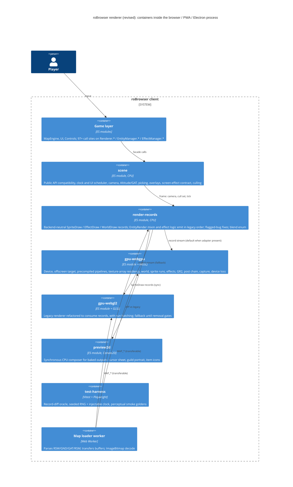

# WebGPU Renderer: Reimagined Architecture

_Status: **awaiting HITL #2 approval**, so nothing has been scaffolded. Spec: [`AI_NATIVE_SPEC.md`](AI_NATIVE_SPEC.md). All 20 capabilities are P0; the flagged legacy bugs default to "fix" (spec §6)._
_Revision 2: the architecture-critic review (§7) has been incorporated. I verified the critic's key claims in legacy code before accepting them._

## 1. Core idea: one draw-record seam, two backends

The renderer is rebuilt around a **backend-neutral draw-record layer**.

Legacy gameplay rendering (the `EntityRender` mixin, effects, damage numbers) mutates a global `SpriteRenderer` and issues GL calls directly: one `drawArrays` per sprite layer, with order implied by call sequence. In the new design:

1. **Rule logic emits plain records in legacy order.** The 143 behaviour rules live here, once. `EntityRender` stays a mixin (AGENTS.md forbids converting it to inheritance) but now emits records instead of drawing.
2. **Backends consume records.** A **WebGPU** backend (the vision) and a refactored **WebGL2** backend (the fallback until removal gates pass) draw the *same* record stream. Neither backend contains rendering rules.
3. **Records are the test oracle.** Rules are checked by comparing records deterministically, with no GPU involved. Only a small smoke set uses golden images.

**Order is sacred.** Each frame produces one instance stream in exact legacy order:

- entities sorted far → near (`EntityManager.js:409-414`);
- within each entity, layers in their draw order;
- the `zIndex++` bias per layer.

Backends draw that stream as **contiguous runs**. A new run starts only when pipeline state changes (blend pair, depth write/test, texture class, STR attachment). There is no regrouping by state. Expected cost is about 2–4 runs per entity, so roughly 600 draws for 200 entities instead of about 3,000 today. Translucent layers keep legacy blend order.

## 2. Module boundaries

There are five modules plus a test harness. Each is a directory under `modernized/webgpu-reimagined/<module>/`.

### 2.1 Ownership

| Module | Capabilities | Rules owned | Entities owned |
|---|---|---|---|
| **scene** | C-01 (API + scheduling), C-02, C-12, C-13, C-15 (culling), C-18 (viewer scene API) | R-CTX-003, 004, 008 (sizing), 011, 013; R-CAM-*; R-PICK-*; R-UI-001…005; R-MAP-023; R-PERF-001, 002; R-PP-011 (picking/overlay mirroring fix) | FrameClock, Scheduler, Camera, Altitude, PickRect, OverlayProjector, ScreenEffects, ViewerScene |
| **render-records** | C-08, C-09 (logic), C-10, C-14 (pose/anim), C-17 (record side) | R-SPR-001…033; R-EFX-001…007, 011, 012, 015…017; R-DMG-*; R-GR2-003…005; R-MAP-016, 017 (CPU matrices); R-UI-002 fix; R-DMG-004/009 fixes | SpriteDraw, EffectDraw, WorldDraw, EffectSystem, EffectSpec, DamageNumber, GR2Pose |
| **gpu-webgpu** | C-01 (device), C-03…07, C-11, C-14 (draw), C-16, C-17 (upload), C-19 (live previews), C-20 | R-CTX-001, 002, 005…007, 009, 010, 012; R-MAP-001…015, 018…022, 024; R-SPR-005, 006, 014, 016 (shader side); R-EFX-008…010, 013, 014, 018; R-PP-001…010, 012; R-GR2-001, 002, 006; R-PERF-003, 004 | RenderDevice, OffscreenTarget, PipelineSet, Residency (texture arrays + palette table), MapGpuScene, SpriteRunRenderer, EffectRenderers, PostChain, Capture |
| **gpu-webgl2** | Same as gpu-webgpu, on WebGL2 | Same GPU-side rules | The existing `src/Renderer` GL code, refactored |
| **preview2d** | C-19 (baked outputs), cursor (R-UI-005) | R-SPR-034 | Preview2DComposer |
| **test-harness** | Verification of everything | All 143 rules as record-level tests; smoke goldens | Recorder, SeededRng, FakeClock, GoldenSet |

### 2.2 Notes per module

**scene** (merges the draft's facade and scene-core)
- Keeps the public API exactly as it is: `Renderer.tick`, `Renderer.render(fn)`, `Renderer.stop`, `Renderer.width/height`, `MapRenderer.setMap/onLoad/free`, `EntityManager.*`, `EffectManager.spam*` and `remove(ctor, …)` with class-name aliases, `Damage.add`, `Camera.*`, `ScreenEffectManager.*`, `SignboardManager.add`, `ItemObject.add/remove`.
- Splits the game clock and UI scheduler out of the GPU loop. The ~30 UI callbacks and `Events.process` run here.
- Owns `Altitude`, which 8 non-render modules plus `EffectTable` use, along with picking and the DOM overlay projection (life bars, names, signboards; R-UI-003 hiding on cull).
- Owns the per-frame non-render steps from R-CTX-010: map sounds (step 22) and the asset-eviction tick (step 24).
- Exposes a map-less **ViewerScene** for the Model, GR2, Effect and Str viewers and the Enchant overlay (C-18). These are budgeted as real work.

**render-records**
- `EntityRender`, `EntityAttachments`, `EntityState` and the other mixins call `Records.sprite({...})` instead of `SpriteRenderer.render()`.
- The R-SPR-012 shadow factor is sampled from the map's CPU shadow map, which `scene`'s map state exposes.
- EffectTable `FUNC` closures stay next to their data. Their signature becomes `FUNC(params, ctx)`, with `ctx = { camera, altitude, screenFx, effects, audio, session }` injected. This removes the DB → Renderer imports without inventing a registry.
- The STR D3D table and the 2D/3D GL table normalise into one blend enum here.
- The flagged-bug fixes live here or in shared WGSL/GLSL includes, so **both backends agree**:
  - R-MAP-010 (water alpha), R-EFX-010 (STR fog), R-DMG-004 (Miss/Lucky), R-DMG-009, R-UI-002 (AP/hunger bars).
  - Shader-side fixes go in shared include files: R-MAP-013, R-PP-006/007/009.

**gpu-webgpu**
- **Single render format.** The scene renders into one offscreen `rgba8unorm` target with **4× MSAA** (`antialias:true` parity, R-CTX-001) and depth24, then resolves and blits to the swapchain. One format and one sample count keep the pipeline key small.
- **Pipelines.** Blend pairs actually used are enumerated at build time from the shipped STR files and EffectTable. They are precompiled with `createRenderPipelineAsync` at device init. If an uncommon pair is still compiling, the draw falls back to normal alpha for that frame. Constant-colour factors (D3D 14/15) set `setBlendConstant` as run state.
- **Residency.** `texture_2d_array` pools per (format r8/rgba8, POT size class 32–512). This matches legacy POT padding and centring (`Client.js:313-361`), so edge filtering and the manual palette bilinear filter behave the same. Slots come from a free list, so nothing is packed or fragmented. Palettes live in one `rgba8unorm` 256×N table. Two samplers, selected per instance, handle `pixelPerfectSprites` without a re-upload. The R-MAP-024 magenta key and mip generation (one owner, R-PERF-003) run here. The damage glyph atlas gets mip gutters.
- **Instance data.** Instance-step vertex buffers for sprite and effect runs work on compatibility-mode devices. Storage buffers are used only for animated RSM matrices and GR2 bones, guarded by `maxStorageBufferBindingSize` (NFR-08).
- **Frame.** One ordered function: a single scene render pass (with the occlusion `GPUQuerySet` attached for R-MAP-019, read back 1–2 frames late, which the existing rule already tolerates), then post passes. There is no frame-graph framework.
- **Fog.** R-MAP-004 fog is one WGSL include shared by the ground, sprite, model, STR and effect shaders.
- **Device loss** (no "restored" event in WebGPU):
  1. Show the R-CTX-006 overlay.
  2. Request a new adapter and device.
  3. Reconfigure the main canvas and every live-preview context.
  4. Re-run `setMap(currentMap)`. Assets re-upload on demand through residency.
  5. If no adapter is available, **switch to the gpu-webgl2 backend mid-session**.
  This also fixes legacy restore, which never rebuilt the map (`Renderer.js:211-238`).
- **Capture.** On request, the resolved frame is copied to a buffer inside the frame, after any VerticalFlip, and given to `ScreenShot.js` as an image. html2canvas then composites the DOM overlays above it.

**gpu-webgl2**
- The current GL code is refactored to consume records, with the same run batching (instanced quads plus texture arrays, available in WebGL2).
- This is also the **first deliverable**: it proves the record seam and gives most of the draw-call win before any WebGPU code exists. See the sequencing in §5.

**preview2d**
- Some legacy `bind2DContext` callers read pixels back synchronously:
  - `CursorManager.js:506` renders, then calls `toDataURL` at `:518` and `:584`.
  - `Guild.js:2410` renders to a scratch canvas, then reads `getImageData` (`:2337`).
- WebGPU canvases can't do that synchronously. So:
  - **Baked outputs** (cursor sheet, guild portrait, ItemInfo/ItemCompare icons, CartDecoration, PvPCount) render here on Canvas2D from the same `SpriteDraw` records.
  - **Live previews** (CharSelect, CharCreate, Equipment, PlayerViewEquip, Sense, SlotMachine, ItemPreview) render on the active GPU backend into their own canvas contexts on the shared device, and are reconfigured on device loss.

**test-harness**
- **Seeded RNG and injectable clock.** The 79 `Math.random` sites in 18 renderer files and `Date.now()` in `EntityManager.js:402` are routed through injectable `rng()` and `now()` first.
- **Record-diff oracle.** The legacy renderer is instrumented to emit the same records (a shim around `SpriteRenderer.render`). The new `render-records` output is then diffed against it on scripted scenes. Each of the 143 rules gets a test. Each flagged rule asserts the *fixed* behaviour and cites the legacy rule ID.
- **Smoke goldens.** About 12 scenes compared with a perceptual tolerance (not bit-exact), rendered on one pinned software adapter (Chromium WebGPU on SwiftShader) for both backends. Bloom goldens come from WebGPU only, because legacy disables bloom on SwiftShader (`Utils/WebGL.js:240-246`).
- Adds `@playwright/test` as a devDependency.

## 3. Technology choices

| Choice | Justification |
|---|---|
| **WebGPU + WGSL** (`?raw` imports) | The vision. Explicit pipelines, instancing and storage buffers |
| **Backend-neutral draw records** | Keeps the 143 rules in one place, gives a deterministic GPU-free oracle, and keeps legacy draw order |
| **Run-length batching in legacy order** (not state bucketing) | Keeps translucent blend order while still cutting draws by about 5× |
| **Single `rgba8unorm` MSAA offscreen target + blit** | One format and one sample count keep the pipeline cache bounded. Matches `antialias:true` |
| **Precompiled pipelines (`createRenderPipelineAsync`) from a build-time blend-pair census** | No mid-combat compile hitches |
| **`texture_2d_array` pools per POT size class** | Matches legacy padding and filtering, has no fragmentation, and needs one bind group |
| **Instance vertex buffers for sprites; storage buffers only for matrices and bones** | Works on compatibility-mode devices (mobile path) |
| **WebGL2 backend kept as fallback, refactored onto records** | WebGPU is not universal. Parity is P0. Removal is gated (§5) |
| **CPU picking and DOM overlays retained** | No rule requires GPU picking. Readback adds latency |
| **Plain ES modules + JSDoc, existing aliases, Vite, Vitest** | Repo conventions (AGENTS.md). Playwright is added only for smoke goldens |

## 4. Data migration

The renderer has **no persistent store**.

1. **Asset formats** (GRF: SPR, ACT, PAL, STR, GND, GAT, RSW, RSM, GR2). **Unchanged.** The existing `Loaders/*` are reused. Only the GPU upload step moves into `gpu-*` residency.
2. **Preferences** (`localStorage`). All existing `GraphicsSettings`, `MapPreferences` and `CameraPreferences` keys are kept. One key is added: `GraphicsSettings.renderer = 'auto' | 'webgpu' | 'webgl'`. No migration script is needed.
3. **Worker channel.** The `MAP_*` payload shapes are kept. Buffers are sent as `transfer` lists. Images are decoded in the worker with `createImageBitmap` instead of main-thread blob-URL decode. The CPU payloads of the current map are kept so device loss can rebuild without re-parsing.
4. **EffectTable.** The table data is unchanged. The 117 `FUNC` closures are rewritten mechanically from imported singletons to the injected `ctx` argument.

## 5. Delivery sequence and removal gates

| Phase | Deliverable | Exit gate |
|---|---|---|
| 1 | test-harness: seeded RNG/clock injection + legacy record shim | Legacy scenes replay deterministically |
| 2 | render-records + scene, with legacy GL drawing records (`gpu-webgl2`) | Record-diff green on all non-flagged rules; no visual change |
| 3 | `gpu-webgl2` run batching + texture-array residency | Smoke goldens within tolerance; draw count measured |
| 4 | `gpu-webgpu`: sprites → world → effects → GR2 → post → previews → capture → viewers | Per-path smoke goldens; all 143 record tests green on both backends |
| 5 | Default `renderer:'auto'` | Smoke set passes on 3 named GPUs (e.g. Intel iGPU, NVIDIA, Apple) |
| 6 | Remove legacy WebGL2 backend | N releases on `auto` with no open rendering regression; WebGPU availability is acceptable for the supported browser list |

## 6. Open decision for HITL #2

**C-19 split.** Under "Everything P0", live previews move to the GPU, but the **baked outputs** (cursor sheet, guild portrait, item icons) stay on a synchronous Canvas2D path (`preview2d`) driven by the same records. Making them async-GPU would change their contracts. Approving this architecture approves that split.

## 7. Critique log (architecture-critic, incorporated)

| # | Severity | Finding | Resolution |
|---|---|---|---|
| B1 | Blocker | State-bucketed instancing reorders translucent layers across entities; attachments can't be bucketed | Run-length batching in legacy order (§1) |
| B2 | Blocker | A frozen legacy fallback duplicates the R-SPR rules, and the flagged-bug fixes would drift | Record seam; both backends consume records (§1, §2) |
| B3 | Blocker | GPU canvases can't serve synchronous `toDataURL`/`getImageData` (cursor, guild portrait) | `preview2d` for baked outputs; live previews on the GPU (§2.2, §6) |
| B4 | Blocker | Legacy goldens contradict the fixes; 79 RNG sites and `Date.now()`; GPUs differ | Record-diff oracle, seeded RNG/clock, perceptual smoke set on a pinned adapter |
| M1 | Major | Device loss has no data story; no WebGPU restore event | Rebuild sequence, retained map payloads, mid-session fallback to WebGL2 |
| M2 | Major | Pipeline-cache explosion and compile hitches; blend constants | Single format/sample target, census plus async precompile, constants as run state |
| M3 | Major | Atlas pages break POT-padding filter parity and fragment | Texture-array pools per POT class, two samplers |
| M4 | Major | Unowned rules (R-PERF-001/002, R-UI-002/005, Altitude, ScreenEffects, sounds/eviction, shadow factor, fog, mips, R-PP-011, MSAA) | All assigned in §2.1/§2.2 |
| M5 | Major | Viewers don't fit one-owner-per-map | `ViewerScene` in `scene`; budgeted |
| M6 | Major | A behaviour registry only renames the coupling | `FUNC(params, ctx)` injection; class-name aliases for `remove` |
| M7 | Major | Rollout depends on telemetry that doesn't exist | Explicit removal gates (§5) |
| m1 | Minor | Frame graph is over-engineered | Dropped in favour of one ordered frame function |
| m2 | Minor | Storage buffers for sprite instances aren't needed and break compat mode | Instance vertex buffers |
| m3 | Minor | Occlusion query lag | Documented (1–2 frames; rule tolerates it) |
| m4 | Minor | Water array needs uniform image size | Normalise at upload |
| m5 | Minor | Main-thread image decode | `createImageBitmap` in the worker |
| m6 | Minor | Facade and scene-core can merge | Merged into `scene` |
| m7 | Minor | Screenshot path unspecified | In-frame capture + html2canvas composite (§2.2) |
| m8 | Minor | GR2 one-frame lag | **Kept as intentional legacy parity** (R-GR2-003); not in the fix list |
