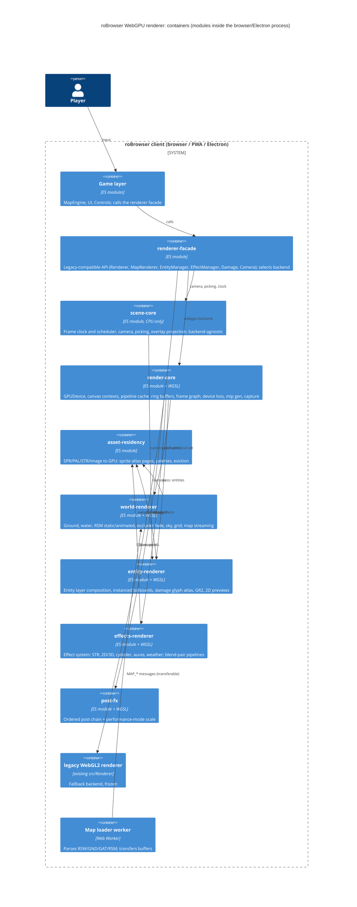

# WebGPU Renderer: Reimagined Architecture (DRAFT, before critique)

_Status: draft for architecture-critic review. Spec: [`AI_NATIVE_SPEC.md`](AI_NATIVE_SPEC.md). All 20 capabilities are P0._

## 1. Shape of the system

The renderer becomes a **retained-mode, data-oriented** subsystem. Legacy issues one draw call per sprite layer through a global mutable `SpriteRenderer`. The new design works as follows:

- Gameplay code writes plain-data **render records** (entity layers, effects, damage numbers) into per-frame arenas.
- Each module turns its records into **instance buffers**.
- A small **frame graph** runs a fixed list of passes. Each pass draws its batches with cached pipelines.

A **backend switch** keeps the legacy WebGL2 renderer as a fallback until parity is proven. The new modules never call WebGL.

## 2. Module boundaries

Each module is a directory under `modernized/webgpu-reimagined/<module>/`.

| Module | Capabilities | Rules owned | Entities owned | Rationale |
|---|---|---|---|---|
| **renderer-facade** | C-01 (API), C-18, C-20 (API) | R-CTX-003, 004, 011 (API side) | — | Keeps all ~180 call sites (`Renderer.*`, `EntityManager.*`, `EffectManager.spam*`, `Damage.add`…) unchanged. Chooses the backend (`auto` → WebGPU if an adapter exists, else legacy). The 5 viewers and `Enchant.js` are re-pointed here instead of raw GL. Strangler boundary |
| **scene-core** | C-02, C-12, C-13 | R-CAM-*, R-PICK-*, R-UI-001, 003, 004, R-CTX-003, 004, 008 (scheduling) | Camera, FrameClock, PickRect, OverlayProjector | CPU only and shared by both backends. Splits the **game clock and UI scheduler** (`Renderer.tick`, `Events.process`, ~30 UI callbacks) out of the GPU loop. Picking stays CPU, as in legacy (no readback latency) |
| **render-core** | C-01, C-15 (knobs), C-20 | R-CTX-001, 002, 005, 006, 007, 008, 009, 010, R-PERF-003 | RenderDevice, PipelineCache, FrameGraph, RingBuffer, MipGenerator | One owner for device, canvas, swapchain and **all GPU lifetimes**. Device-loss recovery rebuilds the module registry. The pipeline cache is keyed by `(shader, blend pair, depth state, topology, format)`. The frame graph encodes the R-CTX-010 pass order as explicit data. Capture uses `copyTextureToBuffer` and composites the DOM overlays |
| **asset-residency** | C-16 | R-MAP-024, R-SPR-014, 016, R-PERF-003 | SpriteAtlasPage, PaletteTable, StrMaterialSet, ImageTexture | Replaces the GPU halves of `Client.js` and `MemoryManager`. Sprite frames are packed into **2048² atlas pages** (`r8unorm` for indexed, `rgba8unorm` for RGBA). Palettes go into one `rgba8unorm` 256×N palette texture indexed per instance, which removes per-layer bind-group churn. Refcounting plus 30 s idle eviction. Device-loss purge |
| **world-renderer** | C-03, C-04, C-05, C-06, C-07, C-17 | R-MAP-001…023, R-CTX-012, 013, R-PERF-004 | MapScene, Ground, Water, StaticModelBatch, AnimatedModel, OccluderFade, CloudField, GridSelector | One owner per map, created and freed as a unit. Animated RSM matrices move to a **storage buffer** (fixing the texture-width limit). Occluder fade uses an occlusion `GPUQuerySet` with async resolve. The worker channel moves to **transferable** buffers. Water is a `texture_2d_array` with 32 layers |
| **entity-renderer** | C-08, C-10, C-14, C-19 | R-SPR-001…034, R-DMG-*, R-GR2-* | EntityLayerComposer, SpriteInstanceBatch, DamageGlyphAtlas, GR2Renderer, PreviewTarget | The CPU **composer** applies R-SPR-001…033 (direction, layer z, tints, halos, trails, attachments) and emits instance records. One **instanced draw per (blend, depth-write) bucket**. Depth correction (R-SPR-005/006) lives in WGSL. Damage numbers use a shared glyph atlas. GR2 bones go in a storage buffer. 2D previews render through the same composer into a separate `GPUCanvasContext` per preview canvas (C-19) |
| **effects-renderer** | C-09 | R-EFX-* | EffectSystem, EffectSpec, StrPlayer, effect kinds | EffectTable becomes **data plus a named-behaviour registry**: closures move behind string keys, so the DB no longer imports renderer classes. Each effect kind owns one WGSL module. Blend pairs (STR D3D table and GL table) normalise to one enum feeding the pipeline cache. Fixes the TwoD/ThreeD/Cylinder leaks by construction |
| **post-fx** | C-11 | R-PP-* | PostChain, PostPass (×10) | An ordered list of passes over `rgba8unorm` ping-pong targets. Bloom has its own mip targets. Performance mode renders at 0.75× and upsamples. Each pass is one WGSL file and one pipeline |

## 3. Technology choices

| Choice | Justification |
|---|---|
| **WebGPU** (`navigator.gpu`), WGSL shaders imported with `?raw` | The vision; instancing, storage buffers and explicit pipelines fix the per-layer draw bottleneck |
| **Plain ES modules + JSDoc types**, same aliases, Vite | Matches the repo conventions (AGENTS.md), so no TypeScript toolchain is added |
| **Legacy WebGL2 renderer kept as the fallback backend** | WebGPU is missing on some Linux and older Safari or Firefox setups. Parity is P0, so players must never lose rendering |
| **One `GPUDevice` shared by the main canvas and preview canvases** | Assets are uploaded once and reused by the C-19 previews and the viewers |
| **Storage buffers** for instances, bones and RSM matrices | Removes the legacy RGBA32F texture hack and the 48-bone uniform cap pressure |
| **Sprite atlas pages + palette table** | Turns thousands of per-layer texture binds into a few bind groups per frame |
| **CPU picking retained** | Legacy picking is CPU-only, synchronous and depends only on the camera. GPU readback would add a frame of latency |
| **DOM overlays retained** (life bars, names, signboards) | They are DOM and accessibility-friendly. Moving them to the GPU is not required by any rule |
| **Vitest** (logic, with a fake GPU) + **Playwright/Chromium with WebGPU** (golden images, both backends) | The repo already uses Vitest, and Chromium is pre-installed. Visual parity is measured against legacy screenshots |

## 4. Data migration

The renderer has **no persistent store**. "Data" here means:

1. **Asset formats** (GRF: SPR, ACT, PAL, STR, GND, GAT, RSW, RSM, GR2). These are **unchanged** and read by the existing `Loaders/*`. Only the GPU upload step is new.
2. **Preferences** (`localStorage` via `Preferences/Graphics.js`, `Map.js`, `Camera.js`). All keys are **kept as-is**. Add `GraphicsSettings.renderer = 'auto' | 'webgpu' | 'webgl'`, defaulting to `auto`. No migration script is needed.
3. **Worker messages.** The `MAP_*` payload shapes are kept. The only change is passing `transfer` lists.
4. **EffectTable.** The ~103 FUNC closures are moved, mechanically, into a behaviour registry keyed by effect ID. The table data itself is unchanged.

Rollout:

1. Ship behind `renderer: 'webgl'` by default.
2. Run golden-image parity per capability.
3. Flip the default to `auto`.
4. Remove the legacy backend once telemetry and feedback show parity.
